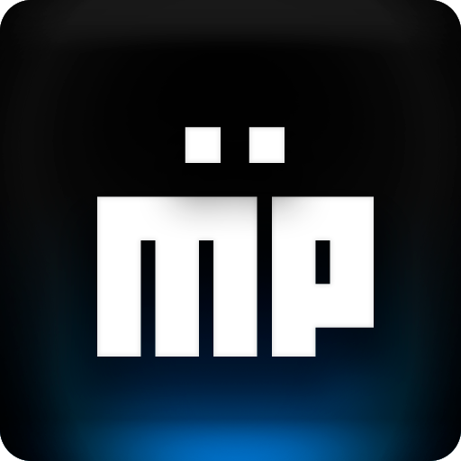
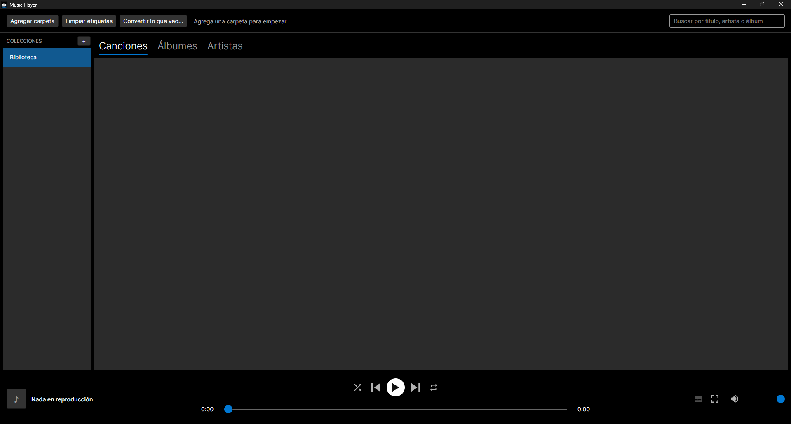
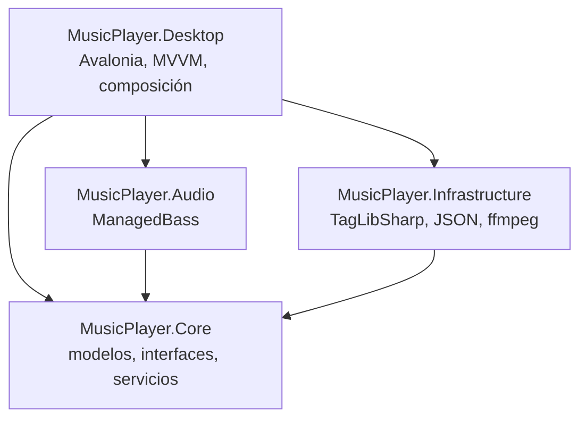

<p align="center">
  
</p>

# MusicPlayer-Desktop

[](https://github.com/Saza4/MusicPlayer-Desktop/actions/workflows/ci.yml)

Reproductor de música de escritorio para archivos locales, hecho con **C#, .NET 8 y Avalonia UI**.
Es un proyecto personal y formativo, pensado como referencia de **Clean Architecture, MVVM, SOLID,
inversión de dependencias y pruebas unitarias**. No usa servicios de streaming ni la red: todas las
funciones trabajan sobre tus archivos. Motivado principalmente por querer ampliar conocimientos y, en cierto modo, por el deseo de tener mi propio reproductor de música local para no depender de servicios de suscripción de pago.



## Funciones

**Reproducción**

- Formatos `.mp3`, `.flac`, `.wav` y `.m4a` con seek, volumen, anterior y siguiente, **sin silencios entre pistas** (BASSmix).
- **Silencio con memoria:** el botón de volumen silencia y restaura el nivel anterior.
- **Aleatorio** (Fisher-Yates sobre una lista de índices) y **repetir** (no / todas / una).
- **Cola dinámica:** "Reproducir siguiente" y "Agregar a la cola" desde el clic derecho.
- **Atajos de teclado** en toda la ventana, salvo al escribir o navegar menús y listas desplegables: barra espaciadora reproduce y pausa, `←` `→` saltan 5 s, `Ctrl+↑` `Ctrl+↓` cambian el volumen un 5 % y `M` silencia. Al abrir la app, el foco queda en la lista de canciones.
- **Barra multimedia con íconos vectoriales** y la lista sincronizada con la pista que suena.
- **Isla flotante (Windows):** con la ventana minimizada o detrás de otra, una pastilla negra arriba al centro de la pantalla muestra lo que suena (miniatura y onda animada). Al pasar el cursor se expande con carátula, título, artista, progreso con el tiempo restante y los controles aleatorio, anterior, reproducir/pausa y siguiente. Un clic en la barra salta a ese punto, y un clic en la carátula o el título trae el reproductor al frente. No roba el foco a la app en la que escribes y deja pasar los clics fuera de la pastilla. Se activa y desactiva desde la barra de reproducción.

**Biblioteca**

- Escaneo de carpetas (con todas sus subcarpetas) en segundo plano, metadatos con TagLibSharp, orden por artista, álbum, disco y pista, y persistencia en JSON. Quitar canciones de la biblioteca o del disco.
- **Búsqueda en tiempo real** por título, artista, artista del álbum y álbum, sin distinguir mayúsculas ni acentos. Cada palabra escrita debe coincidir en alguno de esos campos.
- **Navegación por artista y álbum:** artistas del álbum → álbumes por año → pistas en orden de disco y número. Los recopilatorios se agrupan con la etiqueta "artista del álbum".
- **Playlists:** crear, renombrar, eliminar, agregar y quitar canciones.
- **Detecta archivos movidos o borrados:** se marcan como no disponibles, se saltan al reproducir y se pueden limpiar de la biblioteca y las playlists. Al agregar la carpeta nueva, las pistas movidas se reconocen por título, artista, álbum y duración y conservan sus playlists.
- **Ajustes persistentes:** volumen, opciones de letra, aleatorio, repetir, última canción, tema e isla flotante.

**Letras y carátulas**

- **Letras:** `.lrc` sincronizado (auto-scroll y salto al pulsar una línea) o texto USLT incrustado. Traducción y pronunciación desde archivos hermanos, `cancion.<idioma>.lrc` (con el código del idioma: `cancion.es.lrc`, `cancion.en.lrc`…) y `cancion.rom.lrc`, o incrustadas en el audio; el hermano gana si están los dos. Con varias traducciones se muestra la de tu idioma (el de la interfaz del sistema) o, si no, la primera por orden alfabético.
- **Letra progresiva en el modo inmersivo** (estilo Apple Music): la línea activa se rellena de izquierda a derecha según la posición real, el resto se desplaza con resorte y cascada y se atenúa con la distancia, y las pausas instrumentales largas muestran «♪». Pulsar una línea salta a ella; la rueda o un gesto desplazan a mano y a los 3 s la letra vuelve a su sitio. Las letras sin tiempos y el panel lateral siguen con la lista de siempre.
- **Incrustar letra:** guarda en el archivo, en una sola escritura atómica y verificada, el `.lrc` principal (USLT en MP3, `LYRICS` en FLAC, `©lyr` en M4A) y su traducción y pronunciación (`cancion.<idioma>.lrc` y `cancion.rom.lrc`, en campos propios: `LYRICS_TRANSLATION_ES`, `LYRICS_PRONUNCIATION`). Así puedes quitar los `.lrc` de junto al audio. Desde el clic derecho de la lista; la línea de estado dice qué entró y qué se saltó y por qué.
- **Capas en el modo inmersivo:** un botón arriba a la derecha (con letra sincronizada) muestra u oculta la traducción, la pronunciación y el original (las mismas opciones que el panel lateral). Con el original oculto se rellena la primera capa visible. Al final del menú, **«Incrustar traducción…» e «Incrustar pronunciación…»** abren el selector de archivos: eliges un `.lrc` de cualquier carpeta y se incrusta solo esa capa, sin tocar la letra principal y sin depender de archivos junto a la música. El idioma de la traducción sale del nombre del archivo (`algo.en.lrc`); si no lo trae, se usa el del sistema y la línea de estado lo avisa. Cancelar el selector no corta la música; al escribir, la pista se recarga en el mismo punto. Si un `.es.lrc` sigue junto al audio, ese hermano gana al leer: quítalo para ver la capa incrustada.
- **Carátulas bajo demanda** (incrustadas o un archivo de la carpeta llamado `cover`, `folder`, `front`, `album` o `albumart`, en `.jpg`, `.jpeg` o `.png`, en ese orden de prioridad) con caché LRU.
- **Carátulas editables:** elige una imagen JPG o PNG (máx. 10 MB) o quita la actual, directamente en el archivo (TagLibSharp, escritura atómica). También puedes aplicar una imagen a todo un álbum de una vez.
- **Modo inmersivo** con fondo desenfocado a partir de la carátula (se desenfoca una sola vez, fuera del hilo de la interfaz).

**Temas**

- **Claro, oscuro y modo del sistema** desde el botón «Tema». La lista previsualiza en vivo toda la app al pasar el cursor o moverse con las flechas; clic o `Enter` confirma y `Esc` vuelve al tema anterior. El tema por defecto es Oscuro.
- **Temas propios:** archivos `.json` en `%APPDATA%\MusicPlayer\themes` (`~/.config/MusicPlayer/themes` en Linux), solo datos y sin código. Ver [Temas de usuario](#temas-de-usuario).
- **Botones de acción con icono** en la barra superior («Agregar carpeta», «Limpiar etiquetas», «Convertir lo que veo…» y «Tema») y el «+» de COLECCIONES, con el color del tema y un anillo de foco visible con el teclado. Con la ventana estrecha (menos de 1100 px) quedan solo con icono; el nombre sigue en el globo al pasar el cursor.

**Herramientas de etiquetas y archivos**

- **Editor de etiquetas:** corrige título, artista, artista del álbum, álbum, año, pista y disco directamente en el archivo (TagLibSharp). La canción conserva su identidad y sus playlists.
- **Autocompletar/Limpiar etiquetas (local):** propone, con vista previa, título, artista y número de pista a partir del nombre del archivo, limpia basura de descargas ("Official Video", marcas de agua) y agrupa recopilatorios. Escribe de forma atómica (copia temporal, verificación y reemplazo) y permite deshacer.
- **Convertir formato (local):** MP3, FLAC, WAV y M4A con el `ffmpeg` instalado en tu equipo, para una canción o para toda la lista visible ("Convertir lo que veo…"). Copia etiquetas y carátula, no toca el original, agrega los archivos nuevos a la biblioteca (opcional) y no usa la red.

## Arquitectura



Todas las dependencias apuntan hacia **Core**, que no conoce la interfaz ni ninguna librería externa
(solo usa `System.IO` de .NET para trabajar con archivos). Algunas decisiones:

- **Lógica pura y probada:** la cola (`PlayQueue<T>`), el filtro, el orden, el parser `.lrc`, la
  combinación de letras, el agrupador de álbumes y las reglas de conversión viven en Core y se prueban sin UI. La mayoría tampoco toca el disco.
- **Proveedores componibles:** letras y carátulas siguen el patrón _composite_ y _decorator_, de modo
  que añadir una fuente nueva no modifica las existentes.
- **Persistencia segura:** escritura atómica (archivo temporal y mover), copia `.corrupt` si el JSON
  se daña y DTOs propios para que el formato no dependa de los modelos.
- **Escritura atómica en los archivos de audio:** el editor de etiquetas, el de carátulas y el de letras trabajan sobre una copia temporal, la verifican y la intercambian con el original. Si algo falla, el original queda intacto.
- **Identidad estable de las pistas:** el `Id` de cada canción se conserva al reescanear, reubicar archivos y editar etiquetas, así que las playlists sobreviven.
- **Un solo punto de composición:** el contenedor de dependencias vive únicamente en
  `MusicPlayer.Desktop/CompositionRoot.cs`.

## Estado

| Sistema | Estado                                                                               |
| ------- | ------------------------------------------------------------------------------------ |
| Windows | Compila, pasa las pruebas y se usa a diario                                          |
| Linux   | Compila y pasa las pruebas en CI. La prueba de audio y de la interfaz está pendiente |

## Descargar

Las versiones compiladas para **Windows x64** están en [Releases](https://github.com/Saza4/MusicPlayer-Desktop/releases): descomprime el zip y ejecuta `win-x64\MusicPlayer.Desktop.exe`. Solo necesitas el [.NET 8 Runtime](https://dotnet.microsoft.com/download/dotnet/8.0). El zip ya incluye las bibliotecas de BASS (gratuitas solo para uso no comercial), así que no hay que descargarlas aparte. Las notas de cada versión dicen qué cambió y qué se probó. Para Linux, o para compilar tú mismo, sigue las instrucciones de abajo.

## Requisitos

- [.NET 8 SDK](https://dotnet.microsoft.com/download/dotnet/8.0) para compilar (para ejecutar el zip basta el runtime)
- Binarios nativos de BASS (ver abajo)
- (Opcional) [ffmpeg](https://ffmpeg.org/download.html) para convertir formatos. En Windows: `winget install Gyan.FFmpeg`. Se busca junto al ejecutable y luego en el `PATH`; si lo instalas con la app abierta, reiníciala. No se incluye en este repositorio.

## Compilar y ejecutar

```bash
git clone https://github.com/Saza4/MusicPlayer-Desktop.git
cd MusicPlayer-Desktop
dotnet build
dotnet run --project src/MusicPlayer.Desktop
```

### Binarios de BASS

El motor de audio usa [BASS](https://www.un4seen.com) mediante ManagedBass. Los binarios **no se
incluyen en este repositorio** (el zip de las releases de Windows sí los lleva). Para compilar desde el código, descarga **BASS**, **BASSFLAC**, **BASS_AAC** y **BASSmix** (64 bits) y colócalos así:

```
src/MusicPlayer.Audio/native/win-x64/    bass.dll  bassflac.dll  bass_aac.dll  bassmix.dll
src/MusicPlayer.Audio/native/linux-x64/  libbass.so  libbassflac.so  libbass_aac.so  libbassmix.so
```

El proyecto los copia solo junto al ejecutable. Sin ellos la aplicación no inicia.

## Pruebas

```bash
dotnet test
```

Pruebas unitarias con xUnit en `tests/`: `MusicPlayer.Core.Tests` para la lógica y
`MusicPlayer.Infrastructure.Tests` para repositorios JSON, proveedores y escritores de archivos.
Hay 886 pruebas (704 en Core y 182 en Infrastructure). No cubren la conversión real con `ffmpeg` ni el
código de vista (menús, selectores, foco, teclado, la ventana de la isla y el dibujo de la letra progresiva), que se prueban a mano.
De la isla se prueban en Core las reglas: cuándo se ve, dónde va en cada escala, los pasos del hover y el seek.
De la letra progresiva, el relleno, las pausas, el resorte, el desplazamiento, la atenuación y el desenfoque.

## Limitaciones conocidas

- **Letras incrustadas:** USLT es texto sin sincronizar por especificación; los tiempos `[mm:ss.xx]` viajan dentro del texto y solo esta app los interpreta. Solo UTF-8 de hasta 1 MB por capa. La traducción y la pronunciación incrustadas solo las muestra esta app: otros reproductores ven solo la letra principal. Con el clic derecho hace falta la letra principal para incrustar; desde el modo inmersivo, «Incrustar traducción…» e «Incrustar pronunciación…» eligen el archivo con el selector y no necesitan `cancion.lrc` ni hermanos, pero la pista ya debe tener letra sincronizada. Si un `cancion.es.lrc` sigue junto al audio, ese hermano gana al leer. Formatos con capas: MP3, FLAC y M4A (en WAV, OGG u Opus solo la principal). **Convertir formato** (ffmpeg, comprobado el 8 de noviembre de 2026 de MP3 y M4A a MP3, M4A y FLAC): la letra principal solo sobrevive de M4A a M4A o a FLAC (de MP3, o hacia MP3, ffmpeg la deja en un campo de texto suelto que no es la letra); la traducción y la pronunciación se conservan hacia MP3 y FLAC y se pierden hacia M4A. Sin la principal, las capas tampoco se ven. Si vas a convertir, conserva los `.lrc` o vuelve a incrustar después.
- **Conversión:** convertir a WAV pierde en la práctica las etiquetas y la carátula. Convertir de un formato con pérdida a FLAC o WAV no mejora la calidad.
- **Biblioteca:** las carpetas no se vigilan (para ver música nueva en una carpeta ya agregada, vuelve a usar «Agregar carpeta») y no se pueden quitar; sí canciones sueltas. El género se lee pero no se muestra.
- **Carátulas:** no se redimensionan, así que una portada pesada infla el archivo.
- **Temas:** el texto sigue la variante base (clara u oscura) y no se puede personalizar. El modo inmersivo es siempre oscuro: solo el botón Reproducir/Pausa y los iconos activos siguen el tema.
- **Isla flotante:** solo en Windows (en Linux no se muestra). Siempre en la pantalla principal. No se maneja con el teclado: se pensó para el ratón sin quitar el foco a otras apps.
- **Letra progresiva:** los `.lrc` normales solo traen el inicio de cada línea, así que el relleno avanza uniforme durante una duración estimada. Los `.lrc` enhanced (`<mm:ss.xx>` por palabra) se leen sin mostrar sus etiquetas y el relleno de la línea activa sigue sus tiempos por palabra, de forma continua y suavizada (specs `docs/specs/lrc-enhanced.md` y `docs/specs/lrc-enhanced-fill.md`); las líneas sin tiempos por palabra usan la estimación de siempre. Las medidas de CPU en Release de esta función están pendientes. En árabe o hebreo (de derecha a izquierda) el relleno barre igualmente de izquierda a derecha, aunque los tiempos por palabra lo hacen más visible. El arrastre con el dedo o el lápiz no se ha probado en una pantalla táctil, y en Linux no se ha probado.
- **Linux:** el audio y la interfaz no se han probado.

El detalle completo está en [`docs/reporte-reproductor.md`](docs/reporte-reproductor.md).

## Datos del usuario

`library.json`, `playlists.json` y `settings.json` se guardan en `%APPDATA%\MusicPlayer` (Windows)
o `~/.config/MusicPlayer` (Linux). En la misma carpeta, `errores.log` anota los errores inesperados
(texto local, hasta 256 KB; no se envía a ningún sitio).

## Temas de usuario

Un tema es un archivo `.json` en la carpeta `themes` (el botón «Tema» tiene un acceso a ella). El nombre del archivo es su identificador, y la lista se vuelve a leer cada vez que se abre el selector.

```json
{
  "formatVersion": 1,
  "name": "Medianoche",
  "base": "dark",
  "colors": {
    "background": "#0B0F1A",
    "surface": "#05070D",
    "overlay": "#C0CAF5",
    "primary": "#7AA2F7",
    "onPrimary": "#0B0F1A",
    "accent": "#BB9AF7",
    "danger": "#F7768E",
    "success": "#9ECE6A",
    "warning": "#E0AF68"
  }
}
```

- `base` (`dark` o `light`) decide el color del texto y de los controles; si falta, vale `dark`. Todos los colores son opcionales y los que falten heredan los de la base. Se escriben solo como `#RRGGBB`.
- Un color con formato no válido se ignora (hereda el de la base). Un archivo mal formado, con `formatVersion` distinto de `1` o con un nombre reservado (`system`, `light`, `dark`) se descarta.
- Un tema se rechaza si el texto no se lee sobre `background` o `surface`, si `onPrimary` no se lee sobre `primary`, o si `primary` o `accent` no se ven sobre el velo negro del modo inmersivo (contraste mínimo 3:1). El motivo aparece en la línea de estado al abrir el selector.
- `accent` es opcional: sin él se usa el color de acento del sistema.
- El JSON admite comentarios (`//`, `/* */`) y comas finales. Se leen hasta 50 archivos de 64 KB como máximo, y las claves no distinguen mayúsculas.

## Hoja de ruta

- Integración con el sistema: SMTC en Windows y MPRIS en Linux
- Probar el audio y la interfaz en Linux

## Licencias

El código se distribuye bajo licencia MIT (ver `LICENSE`). BASS pertenece a Un4seen Developments y es
gratuito solo para uso no comercial.
