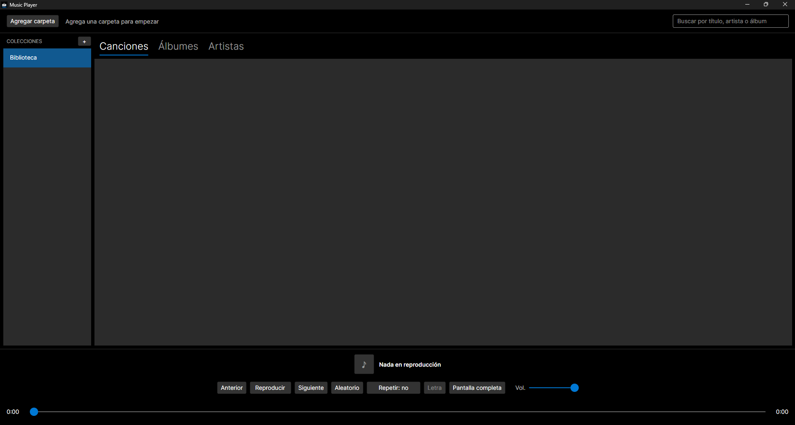
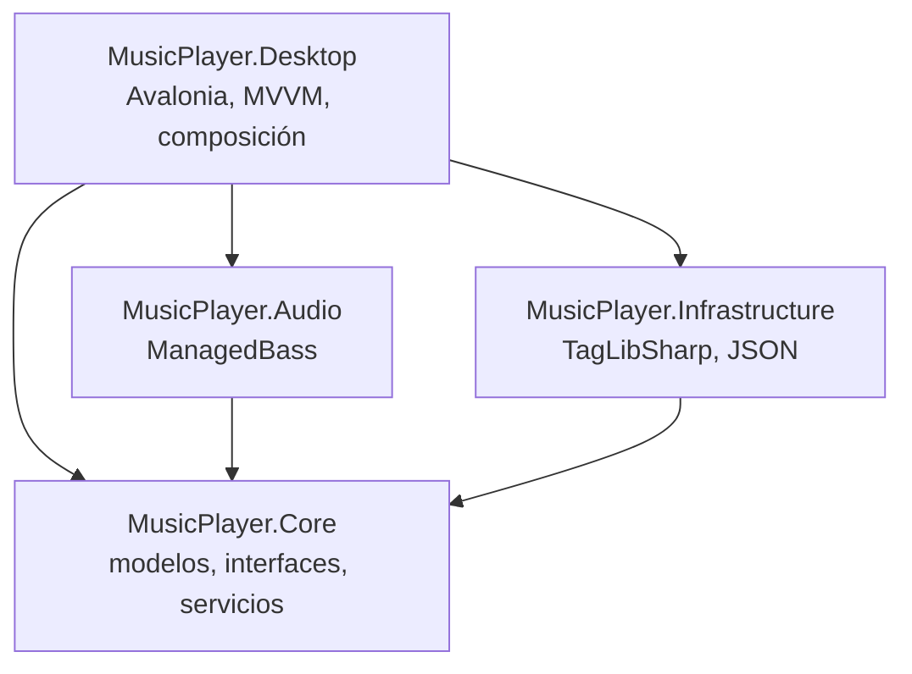

# MusicPlayer-Desktop

[](https://github.com/Saza4/MusicPlayer-Desktop/actions/workflows/ci.yml)

Reproductor de música de escritorio para archivos locales, hecho con **C#, .NET 8 y Avalonia UI**.
Es un proyecto personal y formativo, pensado como referencia de **Clean Architecture, MVVM, SOLID,
inversión de dependencias y pruebas unitarias**. No usa servicios de streaming. Motivado principalmente por querer ampliar conocimientos y, en cierto modo, por el deseo de tener mi propio reproductor de música local para no depender de servicios de suscripción de pago.



## Funciones

- **Reproducción** de `.mp3`, `.flac`, `.wav` y `.m4a` con seek, volumen, anterior y siguiente, **sin silencios entre pistas** (BASSmix).
- **Aleatorio** (Fisher-Yates sobre una lista de índices) y **repetir** (no / todas / una).
- **Cola dinámica:** "Reproducir siguiente" y "Agregar a la cola" desde el clic derecho.
- **Biblioteca:** escaneo de carpetas en segundo plano, metadatos con TagLibSharp, orden por
  artista, álbum, disco y pista, persistencia en JSON. Quitar canciones de la biblioteca o del disco.
- **Búsqueda en tiempo real** por título, artista y álbum, sin distinguir mayúsculas ni acentos.
- **Playlists:** crear, renombrar, eliminar, agregar y quitar canciones.
- **Letras:** `.lrc` sincronizado (auto-scroll y salto al pulsar una línea) o texto USLT incrustado.
  Traducción y pronunciación desde archivos hermanos (`cancion.es.lrc`, `cancion.rom.lrc`).
- **Modo inmersivo** con fondo desenfocado a partir de la carátula.
- **Carátulas bajo demanda** (incrustadas o `cover.jpg`) con caché LRU.
- **Ajustes persistentes:** volumen, opciones de letra, aleatorio, repetir y última canción.
- **Detecta archivos movidos o borrados:** se marcan como no disponibles, se saltan al reproducir y se pueden limpiar de la biblioteca y las playlists. Al agregar la carpeta nueva, las pistas movidas se reconocen por título, artista, álbum y duración y conservan sus playlists.
- **Navegación por artista y álbum:** artistas del álbum → álbumes por año → pistas en orden de disco y número. Los recopilatorios se agrupan con la etiqueta "artista del álbum".
- **Editor de etiquetas:** corrige título, artista, artista del álbum, álbum, año, pista y disco directamente en el archivo (TagLibSharp). La canción conserva su identidad y sus playlists.

## Arquitectura



Todas las dependencias apuntan hacia **Core**, que no conoce la interfaz, el sistema operativo ni
ninguna librería externa. Algunas decisiones:

- **Lógica pura y probada:** la cola (`PlayQueue<T>`), el filtro, el orden, el parser `.lrc`, la
  combinación de letras y las reglas de visualización viven en Core y se prueban sin UI ni disco.
- **Proveedores componibles:** letras y carátulas siguen el patrón _composite_ y _decorator_, de modo
  que añadir una fuente nueva no modifica las existentes.
- **Persistencia segura:** escritura atómica (archivo temporal y mover), copia `.corrupt` si el JSON
  se daña y DTOs propios para que el formato no dependa de los modelos.
- **Un solo punto de composición:** el contenedor de dependencias vive únicamente en
  `MusicPlayer.Desktop/CompositionRoot.cs`.

## Estado

| Sistema | Estado                                                                               |
| ------- | ------------------------------------------------------------------------------------ |
| Windows | Compila, pasa las pruebas y se usa a diario                                          |
| Linux   | Compila y pasa las pruebas en CI. La prueba de audio y de la interfaz está pendiente |

## Requisitos

- [.NET 8 SDK](https://dotnet.microsoft.com/download/dotnet/8.0)
- Binarios nativos de BASS (ver abajo)

## Compilar y ejecutar

```bash
git clone https://github.com/Saza4/MusicPlayer-Desktop.git
cd MusicPlayer-Desktop
dotnet build
dotnet run --project src/MusicPlayer.Desktop
```

### Binarios de BASS

El motor de audio usa [BASS](https://www.un4seen.com) mediante ManagedBass. Los binarios **no se
incluyen en este repositorio**. Descarga **BASS**, **BASSFLAC**, **BASS_AAC** y **BASSmix** (64 bits) y colócalos así:

```
src/MusicPlayer.Audio/native/win-x64/    bass.dll  bassflac.dll  bass_aac.dll  bassmix.dll
src/MusicPlayer.Audio/native/linux-x64/  libbass.so  libbassflac.so  libbass_aac.so  libbassmix.so
```

El proyecto los copia solo junto al ejecutable. Sin ellos la aplicación no inicia.

## Pruebas

```bash
dotnet test
```

Pruebas unitarias con xUnit en `tests/`: `MusicPlayer.Core.Tests` para la lógica y
`MusicPlayer.Infrastructure.Tests` para repositorios JSON y proveedores de archivos.

## Datos del usuario

`library.json`, `playlists.json` y `settings.json` se guardan en `%APPDATA%\MusicPlayer` (Windows)
o `~/.config/MusicPlayer` (Linux).

## Hoja de ruta

- Teclas multimedia del sistema

## Licencias

El código se distribuye bajo licencia MIT (ver `LICENSE`). BASS pertenece a Un4seen Developments y es
gratuito solo para uso no comercial.
