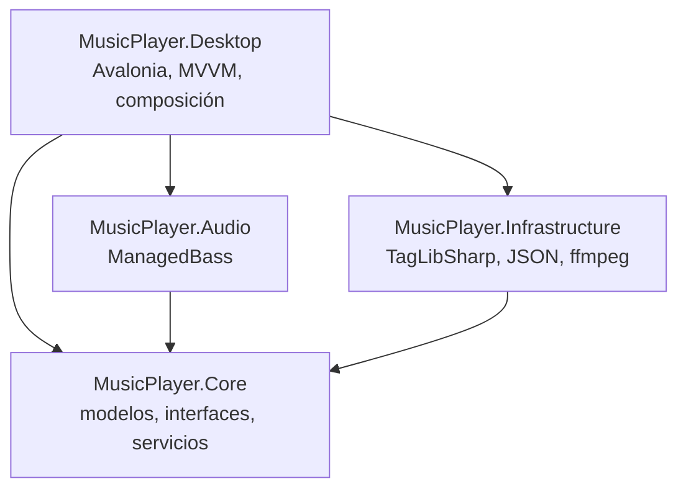

<p align="center">
  
</p>

# MusicPlayer-Desktop

[](https://github.com/Saza4/MusicPlayer-Desktop/actions/workflows/ci.yml)

Reproductor de música de escritorio para archivos locales, hecho con **C#, .NET 8 y Avalonia UI**.
Es un proyecto personal y formativo, pensado como referencia de **Clean Architecture, MVVM, SOLID,
inversión de dependencias y pruebas unitarias**. No usa servicios de streaming ni la red: todas las
funciones trabajan sobre tus archivos. Motivado principalmente por querer ampliar conocimientos y, en cierto modo, por el deseo de tener mi propio reproductor de música local para no depender de servicios de suscripción de pago.


## Funciones

**Reproducción**

- Formatos `.mp3`, `.flac`, `.wav` y `.m4a` con seek, volumen, anterior y siguiente, **sin silencios entre pistas** (BASSmix).
- **Silencio con memoria:** el botón de volumen silencia y restaura el nivel anterior.
- **Aleatorio** (Fisher-Yates sobre una lista de índices) y **repetir** (no / todas / una).
- **Cola dinámica:** "Reproducir siguiente" y "Agregar a la cola" desde el clic derecho.
- **Atajos de teclado** en toda la ventana, salvo al escribir o navegar menús y listas desplegables: barra espaciadora reproduce y pausa, `←` `→` saltan 5 s, `Ctrl+↑` `Ctrl+↓` cambian el volumen un 5 % y `M` silencia. Al abrir la app, el foco queda en la lista de canciones.
- **Barra multimedia con íconos vectoriales** y la lista sincronizada con la pista que suena.

**Biblioteca**

- Escaneo de carpetas en segundo plano, metadatos con TagLibSharp, orden por artista, álbum, disco y pista, y persistencia en JSON. Quitar canciones de la biblioteca o del disco.
- **Búsqueda en tiempo real** por título, artista y álbum, sin distinguir mayúsculas ni acentos.
- **Navegación por artista y álbum:** artistas del álbum → álbumes por año → pistas en orden de disco y número. Los recopilatorios se agrupan con la etiqueta "artista del álbum".
- **Playlists:** crear, renombrar, eliminar, agregar y quitar canciones.
- **Detecta archivos movidos o borrados:** se marcan como no disponibles, se saltan al reproducir y se pueden limpiar de la biblioteca y las playlists. Al agregar la carpeta nueva, las pistas movidas se reconocen por título, artista, álbum y duración y conservan sus playlists.
- **Ajustes persistentes:** volumen, opciones de letra, aleatorio, repetir y última canción.

**Letras y carátulas**

- **Letras:** `.lrc` sincronizado (auto-scroll y salto al pulsar una línea) o texto USLT incrustado. Traducción y pronunciación desde archivos hermanos (`cancion.es.lrc`, `cancion.rom.lrc`).
- **Incrustar letra:** guarda un `.lrc` dentro de las etiquetas del archivo (USLT en MP3, `LYRICS` en FLAC, `©lyr` en M4A) con escritura atómica y verificación, para que la letra viaje con la canción.
- **Carátulas bajo demanda** (incrustadas o `cover.jpg`) con caché LRU.
- **Carátulas editables:** elige una imagen JPG o PNG (máx. 10 MB) o quita la actual, directamente en el archivo (TagLibSharp, escritura atómica). También puedes aplicar una imagen a todo un álbum de una vez.
- **Modo inmersivo** con fondo desenfocado a partir de la carátula.

**Temas**

- **Claro, oscuro y modo del sistema** desde el botón «Tema». La lista previsualiza en vivo toda la app al pasar el cursor o moverse con las flechas; clic o `Enter` confirma y `Esc` vuelve al tema anterior. El tema por defecto es Oscuro.
- **Temas propios:** archivos `.json` en `%APPDATA%\MusicPlayer\themes` (`~/.config/MusicPlayer/themes` en Linux), solo datos y sin código. Ver [Temas de usuario](#temas-de-usuario).

**Herramientas de etiquetas y archivos**

- **Editor de etiquetas:** corrige título, artista, artista del álbum, álbum, año, pista y disco directamente en el archivo (TagLibSharp). La canción conserva su identidad y sus playlists.
- **Autocompletar/Limpiar etiquetas (local):** propone, con vista previa, título, artista y número de pista a partir del nombre del archivo, limpia basura de descargas ("Official Video", marcas de agua) y agrupa recopilatorios. Escribe de forma atómica (copia temporal, verificación y reemplazo) y permite deshacer.
- **Convertir formato (local):** MP3, FLAC, WAV y M4A con el `ffmpeg` instalado en tu equipo, para una canción o para toda la lista visible ("Convertir lo que veo…"). Copia etiquetas y carátula, no toca el original, agrega los archivos nuevos a la biblioteca (opcional) y no usa la red.

## Arquitectura



Todas las dependencias apuntan hacia **Core**, que no conoce la interfaz ni ninguna librería externa
(solo usa `System.IO` de .NET para trabajar con archivos). Algunas decisiones:

- **Lógica pura y probada:** la cola (`PlayQueue<T>`), el filtro, el orden, el parser `.lrc`, la
  combinación de letras, el agrupador de álbumes y las reglas de conversión viven en Core y se prueban sin UI. La mayoría tampoco toca el disco.
- **Proveedores componibles:** letras y carátulas siguen el patrón _composite_ y _decorator_, de modo
  que añadir una fuente nueva no modifica las existentes.
- **Persistencia segura:** escritura atómica (archivo temporal y mover), copia `.corrupt` si el JSON
  se daña y DTOs propios para que el formato no dependa de los modelos.
- **Escritura atómica en los archivos de audio:** el editor de etiquetas, el de carátulas y el de letras trabajan sobre una copia temporal, la verifican y la intercambian con el original. Si algo falla, el original queda intacto.
- **Identidad estable de las pistas:** el `Id` de cada canción se conserva al reescanear, reubicar archivos y editar etiquetas, así que las playlists sobreviven.
- **Un solo punto de composición:** el contenedor de dependencias vive únicamente en
  `MusicPlayer.Desktop/CompositionRoot.cs`.

## Estado

| Sistema | Estado                                                                               |
| ------- | ------------------------------------------------------------------------------------ |
| Windows | Compila, pasa las pruebas y se usa a diario                                          |
| Linux   | Compila y pasa las pruebas en CI. La prueba de audio y de la interfaz está pendiente |

## Requisitos

- [.NET 8 SDK](https://dotnet.microsoft.com/download/dotnet/8.0)
- Binarios nativos de BASS (ver abajo)
- (Opcional) [ffmpeg](https://ffmpeg.org/download.html) para convertir formatos. En Windows: `winget install Gyan.FFmpeg`. Se busca junto al ejecutable y luego en el `PATH`; si lo instalas con la app abierta, reiníciala. No se incluye en este repositorio.

## Compilar y ejecutar

```bash
git clone https://github.com/Saza4/MusicPlayer-Desktop.git
cd MusicPlayer-Desktop
dotnet build
dotnet run --project src/MusicPlayer.Desktop
```

### Binarios de BASS

El motor de audio usa [BASS](https://www.un4seen.com) mediante ManagedBass. Los binarios **no se
incluyen en este repositorio**. Descarga **BASS**, **BASSFLAC**, **BASS_AAC** y **BASSmix** (64 bits) y colócalos así:

```
src/MusicPlayer.Audio/native/win-x64/    bass.dll  bassflac.dll  bass_aac.dll  bassmix.dll
src/MusicPlayer.Audio/native/linux-x64/  libbass.so  libbassflac.so  libbass_aac.so  libbassmix.so
```

El proyecto los copia solo junto al ejecutable. Sin ellos la aplicación no inicia.

## Pruebas

```bash
dotnet test
```

Pruebas unitarias con xUnit en `tests/`: `MusicPlayer.Core.Tests` para la lógica y
`MusicPlayer.Infrastructure.Tests` para repositorios JSON, proveedores y escritores de archivos.
Hay 341 pruebas (284 en Core y 57 en Infrastructure). No cubren la conversión real con `ffmpeg` ni el
código de vista (menús, selectores, foco y teclado), que se prueban a mano.

## Limitaciones conocidas

- **Letras incrustadas:** USLT es texto sin sincronizar por especificación; los tiempos `[mm:ss.xx]` viajan dentro del texto y solo esta app los interpreta. Solo UTF-8 de hasta 1 MB. No se incrustan las traducciones ni la pronunciación. La escritura en FLAC y M4A confía en el mapeo de TagLib y no tiene prueba automática (las pruebas usan MP3).
- **Conversión:** convertir a WAV pierde en la práctica las etiquetas y la carátula. Convertir de un formato con pérdida a FLAC o WAV no mejora la calidad.
- **Carátulas:** no se redimensionan, así que una portada pesada infla el archivo.
- **Temas:** el texto sigue la variante base (clara u oscura) y no se puede personalizar. El modo inmersivo es siempre oscuro: solo el botón Reproducir/Pausa y los iconos activos siguen el tema.
- **Linux:** el audio y la interfaz no se han probado.

El detalle completo está en [`docs/reporte-reproductor.md`](docs/reporte-reproductor.md).

## Datos del usuario

`library.json`, `playlists.json` y `settings.json` se guardan en `%APPDATA%\MusicPlayer` (Windows)
o `~/.config/MusicPlayer` (Linux).

## Temas de usuario

Un tema es un archivo `.json` en la carpeta `themes` (el botón «Tema» tiene un acceso a ella). El nombre del archivo es su identificador, y la lista se vuelve a leer cada vez que se abre el selector.

```json
{
  "formatVersion": 1,
  "name": "Medianoche",
  "base": "dark",
  "colors": {
    "background": "#0B0F1A",
    "surface": "#05070D",
    "overlay": "#C0CAF5",
    "primary": "#7AA2F7",
    "onPrimary": "#0B0F1A",
    "accent": "#BB9AF7",
    "danger": "#F7768E",
    "success": "#9ECE6A",
    "warning": "#E0AF68"
  }
}
```

- `base` (`dark` o `light`) decide el color del texto y de los controles; si falta, vale `dark`. Todos los colores son opcionales y los que falten heredan los de la base. Se escriben solo como `#RRGGBB`.
- Un color con formato no válido se ignora (hereda el de la base). Un archivo mal formado, con `formatVersion` distinto de `1` o con un nombre reservado (`system`, `light`, `dark`) se descarta.
- Un tema se rechaza si el texto no se lee sobre `background` o `surface`, si `onPrimary` no se lee sobre `primary`, o si `primary` o `accent` no se ven sobre el velo negro del modo inmersivo (contraste mínimo 3:1). El motivo aparece en la línea de estado al abrir el selector.
- `accent` es opcional: sin él se usa el color de acento del sistema.

## Hoja de ruta

- Integración con el sistema: SMTC en Windows y MPRIS en Linux
- Probar el audio y la interfaz en Linux

## Licencias

El código se distribuye bajo licencia MIT (ver `LICENSE`). BASS pertenece a Un4seen Developments y es
gratuito solo para uso no comercial.
