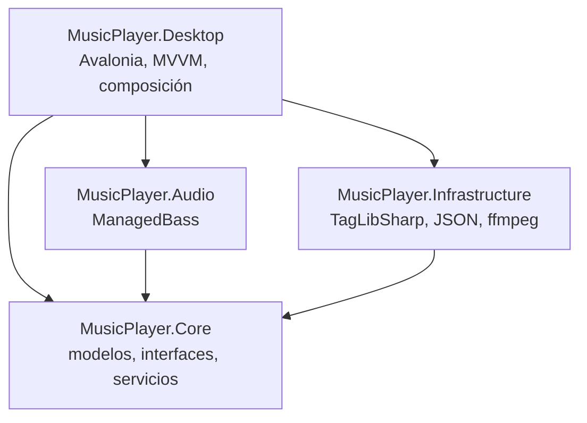

# MusicPlayer-Desktop — Documento maestro y reporte de novedades

> Reproductor de música local, ligero y multiplataforma. **C# · .NET 8 · Avalonia UI 11**.
> Estado a **12 de noviembre de 2026** · última release publicada: **v1.4.0** (8 de noviembre de 2026). **v1.5.0** (letra por palabra de los `.lrc` enhanced y arreglos de las dos auditorías) está preparada: notas y zip listos y revisados con una auditoría previa de solo lectura; falta crear el borrador en GitHub y que el autor lo publique (spec `docs/specs/release-v1.5.0.md`).

Este documento reúne en un solo lugar: la visión y la especificación del proyecto, el reporte de todo lo implementado durante el desarrollo, el historial de versiones tal como se publicó en GitHub Releases, las decisiones de diseño, las limitaciones conocidas y la hoja de ruta. Al final, como anexos, se conserva la especificación original y el prompt maestro.

**Cómo leer el estado de cada novedad:**

- **Hecho:** está en el código que adjuntaste (XAML o ViewModel) y en una release publicada.
- **Entregado:** el código se entregó y compila, pero no hay en el historial un reporte de prueba manual.
- **Solo en notas:** aparece en las notas de release, pero su código no formó parte del trabajo documentado aquí.

## Contenido

1. Visión y principios
2. Entorno y pila tecnológica
3. Arquitectura actual
4. Reporte de novedades
5. Historial de versiones (GitHub Releases)
6. Observaciones sobre las notas de release
7. Pruebas y calidad
8. Problemas resueltos durante el desarrollo
9. Limitaciones conocidas
10. Hoja de ruta
11. Metodología de trabajo
12. Compilar, requisitos y licencias
13. Anexo A: referencia funcional (inspiración)
14. Anexo B: especificación funcional original
15. Anexo C: prompt maestro
16. Anexo D: análisis de funciones esenciales y su estado

---

## 1. Visión y principios

- **Tipo de aplicación:** reproductor de escritorio para archivos de audio locales (`.mp3`, `.flac`, `.wav`, `.m4a`).
- **Enfoque:** uso personal, experimental y formativo, **sin streaming ni servicios de suscripción**. Nace de querer ampliar conocimientos y de tener un reproductor propio que no dependa de pagos.
- **Propósito profesional:** proyecto de referencia para portafolio en GitHub, que documenta Clean Architecture, MVVM, SOLID, inversión de dependencias y pruebas unitarias.
- **100 % local:** ninguna función usa APIs externas, servidores ni nube. Las herramientas de etiquetas, carátulas, letras y conversión trabajan sobre los archivos del usuario, sin red.
- **Portabilidad:** pensado desde el inicio para Windows y Linux, sin acoplarse a Win32, WPF, WinUI ni NAudio.

## 2. Entorno y pila tecnológica

| Elemento                  | Detalle                                                                                      |
| ------------------------- | -------------------------------------------------------------------------------------------- |
| SDK                       | .NET 8 (8.0.427; el repositorio no fija versión con `global.json`)                           |
| Editor                    | Visual Studio Code con C# Dev Kit y la extensión de Avalonia                                 |
| Sistema de desarrollo     | Windows (Linux compila y pasa pruebas en CI; el audio y la interfaz no se han probado allí)  |
| Interfaz                  | Avalonia UI **11.2.5** (se bajó desde la plantilla de Avalonia 12, ver sección 8)            |
| Patrón de UI              | MVVM con CommunityToolkit.Mvvm (`[ObservableProperty]`, `[RelayCommand]`)                    |
| Audio                     | ManagedBass sobre BASS, con BASSFLAC, BASS_AAC y **BASSmix** para reproducción sin silencios |
| Metadatos                 | TagLibSharp (lectura y escritura de etiquetas, carátulas y letras)                           |
| Inyección de dependencias | `Microsoft.Extensions.DependencyInjection`, un único `CompositionRoot.cs`                    |
| Pruebas                   | xUnit                                                                                        |
| Conversión de audio       | `ffmpeg` instalado en el equipo (opcional, no se redistribuye)                               |
| CI                        | GitHub Actions                                                                               |

**Versiones de los paquetes:** Avalonia 11.2.5 (con Fluent e Inter), CommunityToolkit.Mvvm 8.4.2, Microsoft.Extensions.DependencyInjection 8.0.1, ManagedBass y ManagedBass.Mix 4.0.2, TagLibSharp 2.3.0, xunit 2.5.3 (con Microsoft.NET.Test.Sdk 17.8.0 y coverlet 6.0.0). Core no tiene paquetes. Las herramientas de desarrollo de Avalonia (`Avalonia.Diagnostics`) ya no se referencian.

## 3. Arquitectura actual



Todas las dependencias apuntan hacia **Core**, que no conoce la interfaz ni ninguna librería externa. Sí usa `System.IO` de .NET para trabajar con archivos (por ejemplo en `LyricsEditor`, `LibraryScanner` y `ConversionPlanner`).

| Proyecto                     | Responsabilidad                           | Piezas principales                                                                                                                                                                                                                                                                                                                         |
| ---------------------------- | ----------------------------------------- | ------------------------------------------------------------------------------------------------------------------------------------------------------------------------------------------------------------------------------------------------------------------------------------------------------------------------------------------ |
| `MusicPlayer.Core`           | Modelos, contratos y lógica pura          | `Track`, `TrackTags`, `LibrarySnapshot`, `PlayQueue<T>`, `LibraryScanner`, `LibraryService`, `PlaylistManager`, `TrackFilter`, `TrackSorter`, `LibraryGrouper`, `LrcLyricParser`, `LyricsMerger`, `CompositeLyricsProvider`, `CompositeCoverArtProvider`, `LruCache`, `CachedCoverArtProvider`, `TagEditor`, `CoverEditor`, `AlbumScope`, `LyricsEditor`, `ConversionPlanner`, `ConversionService`, `ThemeFactory`, `ThemeCatalog`, `BuiltInThemes`, `ColorContrast`, `PlaybackShortcuts`, `TimeText`, `IslandVisibility`, `IslandPlacement`, `IslandHover`, `ModalTracker`, `TrackRelocator`, `TagSuggester`, `FileNameParser`, `TitleCleaner`, `SettingsService`, `LyricsTiming`, `LyricsTimeline`, `SpringSolver`, `LyricsScroll`, `LyricsAppearance`, `GaussianBlur`, `LyricsLanguage`, `LyricsLayerNames`, `LyricsLayerMenu`, `SeekScrub`, `ThumbnailRequests`, `FilePaths` |
| `MusicPlayer.Audio`          | Motor de sonido                           | `BassAudioPlayer` (implementa `IAudioPlayer` con BASS y BASSmix)                                                                                                                                                                                                                                                                           |
| `MusicPlayer.Infrastructure` | Acceso a archivos y herramientas externas | `TagLibTrackMetadataReader`, `TagLibTrackTagWriter`, `TagLibCoverArtWriter`, `TagLibLyricsWriter`, `SafeFileEdit`, `EmbeddedCoverArtProvider`, `FolderCoverArtProvider`, `EmbeddedLyricsProvider`, `LrcFileLyricsProvider`, `CompanionLyricsProvider`, `TagLibLyricsLayerReader`, `LyricsSiblingFinder`, `FfmpegAudioConverter`, `JsonThemeRepository`, repositorios JSON, `AtomicJson`, `CorruptBackup`, `ErrorLog`, `AppPaths` |
| `MusicPlayer.Desktop`        | Interfaz y composición                    | `MainWindow`, `MainViewModel`, `LyricsViewModel`, `PlaylistViewModel`, `TagEditorViewModel`, `TagAutoFixViewModel`, `ConvertViewModel`, `AlbumCoverViewModel`, `EmbedLyricsViewModel`, `ThemeViewModel`, `ThemeService`, `CoverArtLoader`, `IslandWindow`, `IslandController`, `IslandMetrics`, `NonActivatingWindow`, `WindowNative`, `ProgressiveLyricsView`, `FillTextBlock`, `BlurredBackdrop`, `ProgressiveLyricsMetrics`, `TrackItemViewModel`, `AlbumItemViewModel`, `ArtistItemViewModel`, selectores de archivos y carpetas, estilos y pinceles en `Themes/` (`ThemeBrushes`, `FluentOverrides`, `PlayerButtonStyles`, `ActionButtonStyles`), `CompositionRoot`                                                                              |
| `tests/`                     | Pruebas                                   | `MusicPlayer.Core.Tests`, `MusicPlayer.Infrastructure.Tests`                                                                                                                                                                                                                                                                               |

**Decisiones transversales:**

- **Lógica pura y probada:** la cola, el filtro, el orden, el parser `.lrc`, la combinación de letras, el agrupador de álbumes y las reglas de conversión viven en Core y se prueban sin interfaz. La mayoría tampoco toca el disco; las pruebas de `LyricsEditor`, `LibraryService`, `LibraryScanner` y la conversión usan directorios temporales reales.
- **Proveedores componibles:** letras y carátulas siguen los patrones _composite_ y _decorator_. Añadir una fuente nueva no modifica las existentes.
- **Persistencia segura:** escritura atómica (archivo temporal y reemplazo), copia `.corrupt-<fecha>` si el JSON se daña (se conservan las cinco últimas) y DTOs propios para que el formato no dependa de los modelos.
- **Escritura atómica en los archivos de audio:** `SafeFileEdit` trabaja sobre una copia temporal (`~tags-{guid}.ext`), la edita, la verifica y la intercambia con `File.Replace`. Si algo falla, el original queda intacto. La comparten el editor de etiquetas, el de carátulas y el de letras.
- **Identidad estable de las pistas:** el `Id` de cada canción se conserva al reescanear, reubicar archivos y editar etiquetas, de modo que las playlists sobreviven.
- **Archivos bloqueados en Windows:** antes de escribir en un archivo, el reproductor lo suelta (`Unload` y `PrepareNext(null)`).
- **Un solo punto de composición:** todos los servicios son singletons registrados en `CompositionRoot.cs`, con `ValidateOnBuild`.

### 3.1 Detalles de comportamiento

Reglas finas del código que no aparecen en otras secciones (verificadas contra el código el 8 de noviembre de 2026).

**Biblioteca y búsqueda**

- **Escaneo (`LibraryScanner`):** recorre la carpeta elegida con todas sus subcarpetas (ignora las inaccesibles) y lee `.mp3`, `.flac`, `.wav` y `.m4a`. No se guarda la lista de carpetas agregadas: no se vigilan ni se pueden quitar (ver la sección 9). Un `library.json` antiguo con la clave `Folders` se lee igual: se ignora.
- **Búsqueda (`TrackFilter`):** la consulta se separa en palabras y todas deben coincidir (AND) en título, artista, artista del álbum o álbum, sin distinguir mayúsculas ni acentos. `MainViewModel` espera 200 ms tras la última tecla antes de filtrar.
- **Orden (`TrackSorter`):** el disco 0 cuenta como disco 1.
- **Reubicación (`TrackRelocator`):** solo empareja si la coincidencia por título, artista y álbum es única en ambos lados y la duración difiere como mucho 1 s. Lo ambiguo se deja sin emparejar.
- **Archivos no disponibles:** la comprobación corre sola al arrancar y el botón «Volver a revisar» de la barra de aviso la repite.
- **Navegación:** pestañas Canciones, Álbumes y Artistas (solo en la biblioteca, no dentro de una playlist), un botón de retroceso («← Artistas», «← {artista}», «← Álbumes») y «▶ Reproducir» en la barra del álbum o artista, que reproduce desde el principio.

**Reproducción**

- **Aleatorio (`PlayQueue`):** una vuelta nueva evita empezar por la última pista de la anterior. Si se quita la pista en curso, «Siguiente» sigue desde la anterior.
- **Anterior:** reinicia la pista si ya van más de 3 s; si no, retrocede.
- **Ratón y teclado:** doble clic en una canción la reproduce; `Esc` cierra el modo inmersivo (con el modo inmersivo la ventana pasa a pantalla completa y recuerda su estado anterior).
- **Ajustes (`SettingsService`):** el guardado se aplaza 500 ms; si falla, se reintenta en el siguiente cambio o al cerrar (`FlushAsync`). Si `settings.json` no se pudo leer al arrancar (error de E/S), no se guarda nada hasta una carga correcta, para no sobrescribirlo.
- **Cierre (`App.axaml.cs`):** la app termina al cerrar la ventana principal (`ShutdownMode.OnMainWindowClose`), no la última, porque la isla es una segunda ventana. Al salir guarda los ajustes pendientes y libera el contenedor (y con él BASS).
- **Reloj de la barra:** un temporizador de 250 ms actualiza la posición mientras suena; `_isUpdatingFromTimer` evita que esa actualización vuelva a llamar a `Seek`.
- **Motor (`BassAudioPlayer`):** reproduce a través de un mezclador (BASSmix) con la frecuencia de la pista; la siguiente se añade al mezclador cuando el final de la actual acaba de mezclarse (`Mixtime`) y el aviso `AdvancedToNext` llega cuando ese final ya se oyó. Si no hay siguiente preparada, termina (`TrackEnded`). Si la pista terminó sola, Reproducir la vuelve a abrir. Los plugins `bassflac` y `bass_aac` son opcionales: sin ellos solo se pierde ese formato.

**Etiquetas**

- **Autocompletar (`FileNameParser`, `TitleCleaner`):** el número de pista solo se reconoce con separador explícito (`-`, `.` o `)`) y no si lo que sigue empieza por un dígito («10.000 Reasons»). Los `_` pasan a espacios solo si el nombre no tiene espacios. Se quitan paréntesis o corchetes como «(Official Video)», «[Lyrics]», «(Audio)» o «(Visualizer)», «(HD/HQ/4K)» y las marcas de sitios de descarga al final del título (klickaud, y2mate, ytmp3, savefrom). La casilla «Usar la carpeta como álbum si falta» y los botones «Todas» y «Ninguna» están en el panel. La detección de recopilatorios está siempre activa (`DetectCompilations`, sin casilla en el panel): el artista del álbum se rellena dentro de cada (carpeta, álbum): se toma el único que ya exista o, si no hay ninguno, «Various Artists» cuando hay al menos 3 pistas, al menos 3 artistas distintos y los artistas son la mitad o más de las pistas (`TagSuggester`).
- **Escritura de audio (`SafeFileEdit`):** durante la edición queda `~tags-{guid}.ext` en la carpeta del archivo; si el proceso muere en ese momento, el temporal permanece. La verificación posterior es parcial: título y número de pista en las etiquetas, tamaño de la imagen en la carátula y texto en la letra.

**Letras y carátulas**

- **Capas de letra (`CompanionLyricsProvider`):** las traducciones son `cancion.<idioma>.lrc` con cualquier código ISO 639-1 (con región o escritura opcionales: `pt-BR`, `zh-Hans`) y la pronunciación es `cancion.rom.lrc`; ambas pueden estar también incrustadas en el audio. Se muestra una sola traducción, elegida por idioma entre hermanas e incrustadas (la del sistema, `CultureInfo.CurrentUICulture`; si no, la del mismo idioma; si no, la primera alfabética), y dentro del mismo código el hermano gana. Sin letra principal no se muestra ninguna capa. `.alt`, `.mix` o `.live` no son idiomas y se ignoran.
- **Unión (`LyricsMerger`):** tolerancia de 300 ms entre líneas; en letras sin tiempos solo se une si ambas tienen el mismo número de líneas.
- **Carátula de carpeta (`FolderCoverArtProvider`):** busca `cover`, `folder`, `front`, `album` y `albumart` (`.jpg`, `.jpeg`, `.png`), en ese orden de prioridad. La incrustada se lee con `ReadStyle.None` y prefiere la frontal.

**Persistencia**

- **Formato:** los JSON llevan `Version = 1`. La compatibilidad con archivos antiguos se logra con campos opcionales (por ejemplo `DiscNumber` y `AlbumArtist` en la biblioteca) y porque el deserializador ignora las claves desconocidas, de modo que los ajustes retirados cargan sin problema.
- **Dos implementaciones de escritura atómica:** `AtomicJson` (ajustes, playlists) y `JsonLibraryRepository`, que repite el mismo patrón (`.tmp`, `File.Move`) por su cuenta; las dos comparten el candado por archivo y el respaldo con fecha (`CorruptBackup`).
- **Metadatos sin uso en la interfaz:** el género (`Track.Genre`) se lee y se guarda en `library.json`, pero ninguna pantalla lo muestra, lo filtra ni lo edita.
- **Temas de usuario (`JsonThemeRepository`):** el JSON admite comentarios y comas finales, y un BOM UTF-8 al principio; las claves se leen sin distinguir mayúsculas. El identificador del tema es el nombre del archivo sin extensión.

**Conversión (`FfmpegAudioConverter`)**

- Nunca sobrescribe: usa `-n` y `File.Move` sin sobrescribir. Convierte solo el primer flujo de audio (`-map 0:a:0`) y escribe MP3 con ID3v2.3. Escribe primero en `~conv-{guid}.ext`.

**Isla flotante**

- No aparece en la barra de tareas ni en Alt+Tab (`WS_EX_TOOLWINDOW`).

**Compilación y CI**

- El CI usa Windows y Ubuntu 24.04, `actions/checkout@v7` y `actions/setup-dotnet@v6` con .NET 8.0.x; no publica nada. No hay `global.json` ni `<Version>` en los `.csproj`: la versión vive en el tag de GitHub.

## 4. Reporte de novedades

### 4.1 Resumen

| #   | Novedad                                                   | Capas                         | Estado                                                                              | Release                |
| --- | --------------------------------------------------------- | ----------------------------- | ----------------------------------------------------------------------------------- | ---------------------- |
| 1   | Barra multimedia con íconos vectoriales                   | Desktop                       | Hecho (en `MainWindow.axaml`)                                                       | v1.1.0                 |
| 2   | Botón de silencio con memoria de volumen                  | Desktop                       | Hecho                                                                               | v1.1.0                 |
| 3   | Selección de la lista sincronizada con la pista que suena | Desktop                       | Hecho                                                                               | v1.1.0                 |
| 4   | Carátula editable (JPG o PNG, o quitarla)                 | Core, Infrastructure, Desktop | Entregado; compila y pasa pruebas                                                   | v1.1.0                 |
| 5   | Carátula para todo un álbum                               | Core, Desktop                 | Entregado; compila y pasa pruebas                                                   | v1.1.0                 |
| 6   | Convertidor de audio local con ffmpeg                     | Core, Infrastructure, Desktop | Entregado; compila y pasa pruebas                                                   | v1.1.0                 |
| 7   | Incrustar un `.lrc` en las etiquetas del archivo          | Core, Infrastructure, Desktop | Entregado                                                                           | v1.2.0 (ver sección 6) |
| 8   | Barra espaciadora global y foco inicial                   | Desktop                       | Entregado (commit `f95fb1b`); no figura en las notas                                | v1.2.0                 |
| 9   | Pausa mejorada                                            | Desktop                       | Sin cambio propio en el código: corresponde a la barra espaciadora (#8) (deducción) | v1.2.0                 |
| 11  | Atajos `←` `→`, `Ctrl+↑` `Ctrl+↓` y `M`                   | Core, Desktop                 | Hecho (probado a mano en Windows); compila y pasa pruebas                           | v1.3.0                 |
| 12  | Temas: claro, oscuro, sistema y temas de usuario en JSON  | Core, Infrastructure, Desktop | Entregado; compila, pasa pruebas y se verificó con capturas en Windows (falta la prueba manual del autor) | v1.3.0 |
| 13  | Isla flotante de «ahora suena» (Windows)                  | Core, Infrastructure, Desktop | Hecho: sondas automáticas en Windows y puertas de foco, primer plano y escala probadas a mano por el autor | v1.3.0 |
| 10  | Estilos globales en `App` y `MainWindow`                  | Desktop                       | Hecho (commit `b382184`; se ve en la captura del 4 de noviembre de 2026)            | v1.2.0                 |
| 14  | Letra progresiva en el modo inmersivo (estilo Apple Music) | Core, Desktop                 | Hecho: medida con sondas en Windows y aprobada a mano por el autor                   | v1.4.0 (PR #4) |
| 15  | Capas de letra: traducción y pronunciación incrustadas, y menú de capas en el inmersivo | Core, Infrastructure, Desktop | Hecho: pruebas en MP3, FLAC y M4A, comprobado en la app por UI Automation y probado a mano por el autor en copias | v1.4.0 (PR #5) |
| 16  | Botones de acción: estilo tonal con icono en la barra superior y en el «+» de COLECCIONES | Desktop                       | Hecho: capturas en Windows (Oscuro, Claro y un tema de usuario, a 640, 960 y 1200 px), hover y foco; CI del PR #6 en verde. Sin probar: `Tab` real, pressed y deshabilitado | v1.4.0 (PR #6) |
| 17  | Limpieza de código sin uso (`IAudioPlayer.Stop`, `LyricLine.Words`, `LibrarySnapshot.Folders`, `ViewLocator`…) | Core, Audio, Infrastructure, Desktop | Hecho: build sin errores, 640 + 173 pruebas, la app arranca igual | v1.4.0 (PR #7) |
| 18  | `.lrc` enhanced: lectura de las marcas por palabra y relleno por palabra en el inmersivo | Core, Desktop | Hecho: pruebas con letra sintética, probado a mano y medido en Windows (sin coste de CPU medible). Sin probar con texto de derecha a izquierda | v1.5.0 (PR #9) |
| 19  | Arreglos de dos auditorías: reproducción, entradas no confiables, datos de la biblioteca e interfaz | Core, Audio, Infrastructure, Desktop | Hecho: 959 pruebas y pasada manual del autor en Windows el 11 de noviembre de 2026 (sin detalle paso a paso) | v1.5.0 (PR #10) |

### 4.2 Novedades de la serie v1.1.0

#### Barra multimedia con íconos

Se reemplazaron los botones de texto por íconos vectoriales (`PathIcon`), tomando como guía `referencias.png` (referencias tipo Spotify, Apple Music y reproductores móviles) y los principios de `diseño.md`.

- Estilos reutilizables por clase: `.icon` (botón plano, fondo solo al pasar el cursor), `.skip` (íconos de anterior y siguiente, algo más grandes) y `.play` (círculo sólido y más grande para Reproducir/Pausa, con escala al pasar el cursor y al pulsar).
- Reproducir y Pausa son dos íconos que se funden con una pequeña escala según `IsPlaying`.
- Aleatorio y Repetir muestran su estado con el color de acento y un punto indicador. Repetir una pista añade un «1» sobre el ícono.
- Cada botón de la barra lleva `ToolTip` y `AutomationProperties.Name`, para el cursor y para lectores de pantalla.
- Se conserva el **modo inmersivo** con fondo desenfocado a partir de la carátula, con los mismos controles de íconos.

#### Silencio con memoria

El botón de volumen alterna entre silenciar y restaurar. `MainViewModel` recuerda el último volumen distinto de cero (`_volumeBeforeMute`), cambia el ícono y el texto (`MuteText`) y guarda el volumen en los ajustes.

#### Selección sincronizada

`SyncSelectionWith` lleva el resaltado de la lista a la pista que suena, ya sea por Siguiente, Anterior, avance automático o doble clic. Busca por `Id` y no por referencia, porque tras reescanear la cola puede contener una instancia distinta a la que muestra la lista. Si la pista no está en la lista visible, no toca la selección.

#### Carátula editable

- Desde **Editar etiquetas…** se elige una imagen, se ve una vista previa de 96 px y se guarda junto con el resto de etiquetas. También se puede quitar la carátula actual.
- **Reglas:** solo JPG o PNG, máximo 10 MB, validados por su firma binaria y no por la extensión.
- **Escritura:** `TagLibCoverArtWriter` escribe la imagen como carátula frontal (APIC en ID3, PICTURE en FLAC, `covr` en M4A) con `SafeFileEdit`, y reabre la copia para verificarla antes de reemplazar.
- Si las etiquetas se guardan bien y la carátula falla, no se deshace lo anterior: se avisa del fallo.
- Tras escribir se invalidan la caché de bytes (`ICoverArtCache`) y la miniatura (`CoverArtLoader.Invalidate`), así que la lista muestra la portada nueva.

#### Carátula para todo el álbum

- **Acción:** clic derecho en cualquier canción → **Carátula del álbum…**. Se elige la imagen y se aplica a todas las pistas del álbum, sin panel nuevo. El título del selector de archivos indica el álbum y cuántas canciones recibirán la imagen.
- **Criterio de «mismo álbum»** (`AlbumScope`): mismo nombre de álbum (sin distinguir mayúsculas) y mismo «artista del álbum». Si esa etiqueta está vacía, se usa el artista de la pista. Así los recopilatorios se agrupan bien.
- **Álbum desconocido:** la imagen se aplica solo a la canción pulsada, para no mezclar archivos sin relación.
- **Robustez:** cada archivo se escribe de forma atómica. Si uno falla (bloqueado o de solo lectura), se sigue con los demás y el resumen informa de los errores. La imagen se valida una sola vez, antes de tocar ningún archivo.
- **Reproducción:** si suena una pista del álbum, se detiene antes de escribir, igual que al guardar etiquetas.
- Los archivos no disponibles (movidos o borrados) se omiten y se cuentan en el resumen.

#### Convertidor de audio local

- **Formatos:** MP3, FLAC, WAV y M4A, con el `ffmpeg` del equipo (se busca junto al ejecutable y luego en el `PATH`; en Windows, `winget install Gyan.FFmpeg`).
- **Acciones:** clic derecho → **Convertir formato…** para una canción, o el botón **Convertir lo que veo…** para toda la lista visible (álbum, artista, playlist o biblioteca filtrada).
- **Calidad:** 128, 192, 256 o 320 kbps para MP3 y M4A. FLAC y WAV no usan bitrate.
- **Reglas:** nunca modifica ni sobrescribe el original. El resultado queda junto a él (`tema.flac` → `tema.mp3`, y `tema (1).mp3` si ya existe). Se escribe en un temporal y se renombra al terminar, así que cancelar no deja archivos a medias. Los archivos que ya están en el formato elegido se omiten.
- **Metadatos:** copia etiquetas y carátula. WAV no lleva carátula.
- **Biblioteca:** los archivos nuevos se agregan a la biblioteca, salvo que se desmarque la casilla.
- **Seguridad:** `ffmpeg` se ejecuta como proceso con lista de argumentos, sin pasar por un intérprete de comandos. Al cancelar se termina el árbol de procesos.
- **Por qué ffmpeg:** TagLibSharp solo edita etiquetas y no convierte audio. BASS necesitaría el complemento BASSenc, además de codificadores y licencias adicionales.

### 4.3 Novedades de la serie v1.2.0

#### Incrustar un `.lrc` en las etiquetas

- **Acción:** clic derecho → **Incrustar letra (.lrc)…**. Si junto a la canción existe un `.lrc` con su mismo nombre, se usa ese sin preguntar. Si no, se abre un selector de archivos (`.lrc` o `.txt`).
- **Escritura:** `TagLibLyricsWriter` usa `Tag.Lyrics`, que TagLib traduce a USLT en MP3, `LYRICS` en FLAC y `©lyr` en M4A. Borra antes cualquier letra incrustada anterior, escribe con `SafeFileEdit` y verifica la copia antes de reemplazar el original.
- **Lectura:** la app ya leía la letra incrustada con `Tag.Lyrics` y la pasaba por el mismo parser de `.lrc` que usa con los archivos sueltos. Por eso lo incrustado se ve sincronizado, sin cambios en la lectura.
- **Reglas de `LyricsEditor`:** el archivo debe ser UTF-8 válido (se rechaza en lugar de incrustar caracteres rotos de forma permanente), pesar como máximo 1 MB y no estar vacío.
- **Reproducción:** si la pista suena, se detiene antes de escribir.

#### Barra espaciadora y foco inicial

- **Causa del problema:** `MainWindow` no tenía ningún manejador para la barra espaciadora (solo Escape en modo inmersivo), y al arrancar Avalonia no enfoca ningún control. Después de un clic, el control enfocado se quedaba con la barra para lo suyo (un botón se activaba, una fila se seleccionaba).
- **Foco inicial:** al abrir la ventana se llama a `Activate()` y el foco lógico queda en la lista de canciones (`SongList`), de modo que las flechas funcionan desde el primer momento.
- **Espacio global:** un manejador de tipo _tunnel_ en la ventana alterna reproducir y pausar con `TogglePlayPauseCommand`, antes de que el control enfocado reciba la tecla.
- **Excepciones:** no intercepta la barra cuando el foco está en `TextBox`, `ComboBox`, `ComboBoxItem`, `CheckBox` o `MenuItem`, que la necesitan para escribir, abrir listas, marcar casillas o activar menús. Tampoco con Ctrl, Alt o Mayús. Esta excepción de `CheckBox` vale solo para la barra espaciadora (`MainWindow.axaml.cs`, `OnPreviewKeyDown`): `OwnsKeyboard` no incluye `CheckBox`, así que `M`, `←`, `→` y `Ctrl+↑` `Ctrl+↓` (4.3.1) sí actúan con una casilla enfocada.

#### Pausa mejorada y estilos globales

- **Pausa mejorada:** entre v1.1.0 y v1.2.0 no cambia nada en `MusicPlayer.Audio` ni en `TogglePlayPause` (`MainViewModel`). El único cambio de reproducir y pausar de la release es el manejador de la barra espaciadora (commit `f95fb1b`). _Deducción:_ la nota «Pausa mejorada» describe ese cambio; «transición suave y sin interrupciones» va más allá de lo que hace el código.
- **Estilos globales** (commit `b382184`):
  - `App.axaml` fija `RequestedThemeVariant="Dark"`: la app ya no sigue el tema claro u oscuro del sistema (en v1.2.0; desde v1.3.0 Oscuro es el tema por defecto y el tema del sistema es una opción, ver 4.3.2).
  - Paleta: fondo `#0F0F0F`, paneles `#000000` y velos blancos translúcidos (`#14FFFFFF`, `#1FFFFFFF`, `#26FFFFFF`).
  - Estilos para `ListBox` y `ListBoxItem` (pasar el cursor y la selección en gris en lugar del color de acento), `FlyoutPresenter`, `MenuFlyoutPresenter`, `ContextMenu` y `ToolTip`.
  - Diccionario `ThemeDictionaries["Dark"]` para botones, cuadros de texto, `ComboBox`, filas de lista y menús.
  - En `MainWindow.axaml`, la ventana usa fondo `#0F0F0F` y la barra superior, los paneles de convertir, autocompletar y editar etiquetas, la barra de reproducción, la edición de playlists y el panel de letra pasan a `#000000` con bordes `#1FFFFFFF`.
  - **Captura del 4 de noviembre de 2026 (Windows):** se ven el fondo oscuro, los paneles negros y la fila seleccionada en gris. Las barras de progreso y de volumen conservan el azul de acento de Fluent, porque los estilos no cubren `Slider`.

### 4.3.1 Atajos de salto, volumen y silencio (v1.3.0)

- **Teclas:** `←` y `→` saltan 5 s; `Ctrl+↑` y `Ctrl+↓` cambian el volumen un 5 %; `M` silencia y restaura (`ToggleMuteCommand`). `↑` `↓` sin modificador siguen moviendo las listas: por eso el volumen lleva `Ctrl`.
- **Límites:** `←` llega como mínimo a 0:00; `→` a menos de 5 s del final no hace nada (no cambia de pista). El volumen va de 0 a 100 % en porcentajes enteros, sin deriva de coma flotante.
- **Tecla mantenida:** saltos y volumen se limitan a un paso cada 100 ms; `M` no repite hasta soltar la tecla.
- **Excepciones:** no se interceptan en `TextBox`, `ComboBox`, `ComboBoxItem`, `MenuItem` ni `ContextMenu`. Sliders, listas y botones sí.
- **Piezas:** `PlaybackShortcuts` (Core: `SeekTarget`, `StepVolume`), `MainViewModel.SeekBy` y `ChangeVolume`, y `OnPreviewKeyDown` / `OnPreviewKeyUp` en `MainWindow.axaml.cs`. 16 pruebas nuevas en Core.

### 4.3.2 Temas de la interfaz (v1.3.0)

- **Selector:** botón «Tema» en la barra superior con una lista (Sistema, Oscuro, Claro y los temas de usuario). Mover el cursor o las flechas por la lista **previsualiza** el tema en toda la app sin guardar nada; clic o `Enter` lo confirma y lo guarda en los ajustes (`ThemeId`); `Esc` o cerrar la lista restaura el tema confirmado. Mientras la lista está abierta no actúan los atajos globales de teclado.
- **Tema por defecto:** Oscuro, con los colores exactos que tenía la interfaz. *Sistema* sigue el tema de Windows y reacciona si cambia con la app abierta.
- **Recursos del tema (nueve colores):** `background`, `surface`, `overlay`, `primary`, `onPrimary`, `accent` (opcional: si falta, el acento del sistema), `danger`, `success` y `warning`. Los velos translúcidos (hover, selección, bordes) son `overlay` con una escalera fija de opacidades: las mismas del diseño anterior. El texto no es configurable: sigue la variante de Fluent (clara u oscura) de la `base`.
- **Cómo se aplica:** `ThemeService` fija la variante de Fluent y escribe los nueve `Color` en los recursos de la aplicación; los pinceles de `Themes/ThemeBrushes.axaml` y las claves de Fluent de `Themes/FluentOverrides.axaml` los leen con `DynamicResource`, así que el cambio es inmediato. `App.axaml.cs` aplica el tema guardado antes de mostrar la ventana.
- **Temas de usuario:** archivos `.json` en `%APPDATA%\MusicPlayer\themes` (formato en el README). `JsonThemeRepository` nunca lanza: cada archivo roto es un error con su motivo, que se muestra en la línea de estado al abrir el selector, y los demás siguen funcionando. Máximo 50 archivos de 64 KB. Un color con formato no válido o desconocido solo da un aviso y hereda el de la base.
- **Validación (`ThemeFactory`, en Core):** descarta el tema con JSON mal formado, `formatVersion` ausente o distinto de 1, `base` no válida, nombre reservado o contraste menor de 3:1 en: texto contra `background`, texto contra `surface`, `onPrimary` contra `primary`, y `primary` y `accent` contra el velo negro del modo inmersivo.
- **Tema guardado que ya no existe:** la app arranca en Oscuro y no sobrescribe el ajuste.
- **Modo inmersivo:** igual que antes (fondo desenfocado, velo negro, texto e iconos blancos). Solo el círculo de Reproducir/Pausa y los iconos activos (Aleatorio, Repetir, Letra) toman los colores del tema.
- **Diferencia con la especificación:** se pensó redefinir los colores en el `Grid` inmersivo con recursos locales; no sirve, porque un pincel de la aplicación resuelve su `Color` desde la aplicación y no desde el control que lo usa. El inmersivo conserva sus literales (fondo, degradado y marcador de carátula).
- **Verificado en Windows** (capturas automáticas): arranque en Oscuro idéntico al anterior, vista previa con ratón y con flechas, `Esc`, confirmar y conservar al reiniciar, *Sistema* siguiendo a Windows en vivo, un tema de usuario, tres archivos inválidos descartados, tema guardado inexistente y modo inmersivo. Quedan por probar a mano: Linux y un recorrido completo por todos los paneles con el tema Claro.

### 4.3.3 Isla flotante de «ahora suena» (v1.3.0)

Especificación, decisiones y resultados medidos de cada hito: `docs/specs/dynamic-island.md`.

- **Qué es:** una ventana aparte (`IslandWindow`), sin bordes, transparente y siempre encima, con una pastilla negra arriba al centro de la pantalla principal (a 8 px del área de trabajo). Se ve solo con una pista cargada, el ajuste «Mostrar isla» activado, fuera del modo inmersivo, con la ventana principal no activa (minimizada o detrás de otra) y sin un selector de archivos abierto (`IslandVisibility`). Los cambios esperan 150 ms a estabilizarse y se muestran con un fundido, así que un Alt+Tab rápido no la hace parpadear.
- **Colapsada** (180×36): miniatura y onda. **Expandida al pasar el cursor** (340×144, 400 ms con `SplineEasing`; colapsa 200 ms después de salir): carátula, título y artista con «…», onda, progreso con el tiempo transcurrido y el restante (`−1:31`) y los controles aleatorio, anterior, reproducir/pausa (más grande) y siguiente, con los mismos estilos que la barra principal. Un clic en la barra salta a ese punto (`SeekToFraction`, un solo `Seek` por clic). Un clic en la carátula o el título trae la ventana principal al frente (la restaura a su estado anterior, maximizada incluida). Todas las medidas y tiempos están en `IslandMetrics`.
- **No molesta:** no se activa al pulsarla (`WS_EX_NOACTIVATE`), así que quien escribe en otra app no pierde el foco. Fuera de la pastilla los clics pasan a lo que hay debajo: la ventana no cambia de tamaño y lo que cambia es su región de clics (`SetWindowRgn`), que en reposo es la pastilla más 2 DIPs.
- **Colores:** fondo negro y texto blanco fijos (`ThemeIsland*`) con cualquier tema; play/pausa, aleatorio activo y onda toman el color del tema.
- **Ajuste:** botón en la barra de reproducción («Mostrar/Ocultar isla flotante»), guardado en `settings.json` (`ShowIsland`, activado por defecto; un JSON antiguo sin la clave lo deja activado). Solo en Windows: en Linux el botón no aparece y la isla no se crea.
- **Coste:** la onda se anima a 15 fps solo con la isla visible y la pista sonando. Con la isla visible y sonando, la CPU es la misma que sin animación (medido; la animación de Avalonia la triplicaba).
- **Selectores:** `ModalTracker` cuenta los selectores nativos abiertos (carpeta, imagen y letra) para que la isla no aparezca encima mientras desactivan la ventana principal.
- **Verificación:** sondas automáticas en Windows para posición, foco, clics a través, saltos durante la animación (0 en ~2 500 muestras), comandos, seek, CPU, monitores, temas, modo inmersivo y carátula ausente. A mano: hover y bordes con la Lupa, foco con el Bloc de notas, primer plano al pulsar el título y escala de la pantalla principal. Modo de depuración: en Debug, `MUSICPLAYER_ISLAND_FORCE=1` la muestra con la ventana principal activa.

### 4.3.4 Letra progresiva en el modo inmersivo (v1.4.0)

Especificación, decisiones y medidas de cada hito (M0-M6): `docs/specs/lyrics-progressive.md`.

- **Qué es:** en el modo inmersivo, la letra sincronizada se muestra completa con la línea activa a un 35 % del alto, rellenándose de izquierda a derecha según la posición real (con borde suave). Las demás se atenúan y encogen un poco con la distancia; las de los bordes se funden. Al cambiar de línea, todo se desplaza con un resorte (el `spring()` de SwiftUI) y en cascada. Las pausas instrumentales de 8 s o más muestran «♪», que se rellena con su avance.
- **Referencia:** `ProgressingStyleLyrics.swift` (Magesh Sridhar). Se replica el resultado, no la implementación: todo se deriva de la posición, así que saltar, pausar o cambiar de pista siempre deja la letra bien.
- **Interacción:** pulsar una línea (o «♪») salta a ella. La rueda o arrastrar con el dedo desplazan a mano, y a los 3 s sin tocar nada vuelve el desplazamiento automático. Un salto de más de una pantalla se coloca sin animar.
- **Qué no cambia:** el panel lateral y las letras sin tiempos (`Plain`) siguen con la lista clásica. La traducción y la pronunciación se muestran con las opciones de siempre; solo se rellena el texto original.
- **Coste:** reloj propio a 30 fps pedidos (~24 reales) que solo corre mientras hay algo que mover; en pausa, 0 fotogramas. Con rueda y desplazamientos, +3,4 puntos de un núcleo en Release frente a la lista clásica (tope fijado: +5). La carátula del fondo se desenfoca una sola vez, a 1/12 y fuera del hilo de la interfaz, en lugar de un `blur(60)` recalculado en cada fotograma.
- **Descartado:** desenfoque de las líneas inactivas (por diseño), «reducir movimiento» (decisión del autor tras verlo hecho; Avalonia 11.2.5 no expone la preferencia del sistema) y 20 fps (no hicieron falta).
- **Ajustes:** ninguno. El interruptor temporal Clásico/Progresivo y su ajuste `LyricsStyle` se retiraron al aprobarse el estilo (último commit con ellos: `cb75cf6`). Un `settings.json` que aún los tenga carga igual.
- **Verificación:** sondas en Windows (CPU por pasadas, ráfagas de capturas, rueda enviada como mensaje, `settings.json` restaurado idéntico por hash) y prueba a mano del autor: relleno, saltos cortos y largos, rueda, pulsar una línea, cambio de pista a mitad de línea, redimensionar, traducción y pronunciación, y el fondo tras editar la carátula. Sin probar: arrastre en pantalla táctil y Linux.

### 4.3.5 Capas de letra (v1.4.0)

Especificación, decisiones y resultado de cada hito (M0-M7): `docs/specs/lyrics-layers.md`.

- **Qué es:** «Incrustar letra (.lrc)…» guarda también la traducción (`cancion.<idioma>.lrc`) y la pronunciación (`cancion.rom.lrc`) en el archivo de audio, en la misma escritura atómica que la principal. Al leer, cada capa sale del hermano o, si no está, del archivo. La principal y las capas hermanas se incrustan desde el clic derecho; desde el menú de capas del modo inmersivo se incrusta **una capa a la vez** con el selector de archivos (M7).
- **Dónde se guarda:** la principal, en su campo de siempre (USLT, `LYRICS`, `©lyr`); las capas, en campos propios con el mismo nombre en los tres formatos: `LYRICS_TRANSLATION_<CÓDIGO>` y `LYRICS_PRONUNCIATION` (TXXX en MP3, comentario Vorbis en FLAC, átomo `----:com.apple.iTunes` en M4A). Se escriben en mayúsculas y se leen sin distinguirlas. Otro reproductor nunca muestra la traducción como letra principal.
- **Idiomas:** el código es ISO 639-1 con región (`pt-BR`, `es-419`) o escritura (`zh-Hans`) opcionales; `.alt`, `.mix` o `.live` no son traducciones. Se muestra una traducción: la del idioma exacto del sistema; si no, la del mismo idioma; si no, la primera alfabética. Dentro del mismo código, el hermano gana.
- **Validación por capa:** UTF-8 estricto, 1 MB, con letra y del mismo tipo que el original (una capa sin marcas con un original sincronizado se ignoraría al leer, así que se salta). Principal inválido: no se escribe nada. Capa inválida: se salta y la línea de estado dice por qué.
- **Menú de capas del inmersivo:** botón arriba a la derecha, con letra sincronizada (haya o no capas). «Mostrar/Ocultar» traducción, pronunciación y original (cada una solo si existe), con las mismas preferencias que el panel lateral; se desactiva lo que dejaría todo oculto, y la traducción lleva el código si no es de tu idioma. Con el original oculto, se rellena la primera capa visible. **Aspecto:** vidrio oscuro translúcido con esquinas redondeadas, borde fino y filas con velo blanco al pasar el cursor, siempre oscuro con cualquier tema, para integrarse con el fondo desenfocado (clase `immersive` en `App.axaml`; pinceles `ThemeImmersiveMenu*`).
- **Incrustar una capa con selector (M7):** al final del menú, «Incrustar traducción…» e «Incrustar pronunciación…» (sustituyen a «Incrustar letras en el archivo», que tomaba los hermanos y exigía `cancion.lrc`). Cada una abre el selector nativo (dentro de `ModalTracker`) para elegir un `.lrc` de cualquier carpeta y escribe solo esa capa (`ILyricsWriter.WriteLayers`, `LyricsEditor.EmbedLayerAsync`), sin reescribir la letra principal. La valida contra la letra cargada (UTF-8, 1 MB, con marcas de tiempo si la principal las tiene) y, si no vale, no toca el archivo y dice por qué. **Idioma de la traducción:** el del nombre del archivo (`LyricsLanguage.FromFileName`: `algo.en.lrc`, `x.pt-BR.lrc`); si no lo trae (`traduccion.lrc`, `.rom`, `.alt`), el del sistema, y la línea de estado lo avisa. **Reproducción:** el selector se abre antes de soltar el archivo, así que cancelar no corta la música; al elegir, la pista se descarga, se escribe y vuelve a cargarse en el punto en que estaba y sigue sonando si sonaba. Limitación: un hermano `cancion.es.lrc` aún junto al audio gana al leer, así que la capa incrustada no se vería hasta quitarlo.
- **Verificación:** pruebas en MP3, FLAC y M4A (escritura, lectura, prioridad, conservación de las capas al editar etiquetas, limpiar etiquetas y poner, quitar o aplicar a un álbum la carátula); la app, comprobada por UI Automation y capturas en Windows; y prueba a mano del autor en copias (incrustar en los tres formatos y leer la letra con los `.lrc` movidos).

### 4.3.6 Botones de acción (PR #6, v1.4.0)

Especificación, decisiones y resultado de cada hito (M0-M6): `docs/specs/action-buttons.md`.

- **Qué es:** «Agregar carpeta», «Limpiar etiquetas», «Convertir lo que veo…», «Tema» y el «+» de COLECCIONES comparten un estilo propio: píldora tonal (velo del tema, sin borde visible), con un icono vectorial de 16 px a la izquierda del texto. El «+» es solo icono (círculo de 28 px) y ahora tiene `ToolTip` y `AutomationProperties.Name` («Nueva playlist»). Es solo visual: comandos, bindings y comportamiento no cambian.
- **Es opt-in:** se activa con `Classes="action"` (y `only` para solo icono) en `Themes/ActionButtonStyles.axaml`; no toca los `ButtonBackground*` globales, así que los demás botones (Guardar, Cancelar, Renombrar, Eliminar, «Carpeta de temas», inmersivo, isla) se ven igual.
- **Estados:** reposo `ThemeOverlayHoverBrush`; hover `ThemeOverlaySelectedHoverBrush`; pressed `ThemeOverlaySelectedBrush` y escala 0,97; deshabilitado al 50 %. El foco con teclado dibuja un anillo de 2 px que no mueve el diseño, con el pincel `ThemeFocusRingBrush` (el color de texto de la variante, en `FluentOverrides.axaml`). No usa el acento porque `ThemeFactory` solo le garantiza 3:1 contra el velo negro del inmersivo, no contra el fondo. Se anula el adorno rectangular de Fluent, que no seguía la píldora.
- **Reglas de `diseño.md`:** ese documento solo trae principios (familiaridad, simplicidad, constancia, accesibilidad…), no reglas de botón; la spec deriva de ellos las reglas concretas y el lenguaje de `.icon`, y las marca como decisiones propias.
- **Ventana estrecha:** por debajo de 1100 px de ancho, `MainWindow.axaml.cs` pone la clase `compact` a la barra superior y los botones quedan solo con icono (el texto sigue en `ToolTip` y `AutomationProperties.Name`). Con texto, la fila no cabe: a 640 px ya se solapaba con el cuadro de búsqueda antes de este cambio, y a 960 px el texto de estado quedaba sin sitio.
- **Verificación:** `dotnet build` (mismo aviso CS8602), 641 + 173 pruebas en verde y capturas de la ventana en Windows con los temas Oscuro, Claro y uno de usuario, a 640, 960 y 1200 px, además de hover y foco. El recorrido con `Tab` real no se pudo automatizar (las teclas sintéticas no movían el foco); el foco se comprobó enfocando el botón por código con `NavigationMethod.Tab`, un cambio temporal ya revertido.

### 4.3.7 Limpieza de código sin uso (PR #7, v1.4.0)

Se quitó lo que ningún camino de la app ejecutaba. Cada pieza se comprobó con búsquedas en `src` y `tests`, y con el analizador de .NET (`dotnet format style --diagnostics IDE0051 IDE0052 IDE0060`).

- **Audio y Core:** `IAudioPlayer.Stop()` y su implementación en `BassAudioPlayer` (la interfaz usa `Pause`, `Seek` y `Unload`); `BassAudioPlayer.LoadedPlugins` (se llenaba y nadie lo leía; los plugins se siguen cargando); `LyricLine.Words` y `LyricWord` (siempre `null`, reservados para la sincronía por palabra que no existe); el campo `LyricsTimeline._gaps` y el campo `LyricsViewModel._track`, que se asignaban y no se leían nunca.
- **Biblioteca:** `LibraryService.AddFolderAsync` (la app llama a `ScanFolderAsync`; solo lo usaban las pruebas) y `LibrarySnapshot.Folders`, una lista de carpetas que se guardaba en `library.json` y nada leía. **Compatibilidad:** un `library.json` anterior con la clave `Folders` se carga igual (el deserializador ignora claves desconocidas, y una prueba lo cubre); uno nuevo ya no la escribe.
- **Desktop:** `ViewLocator.cs` y su `DataTemplate` en `App.axaml` (de la plantilla de Avalonia; la interfaz no usa ViewModels como contenido), la entrada `<Folder Include="Models"/>` del `.csproj`, la referencia a `Avalonia.Diagnostics` (sin llamar a `AttachDevTools`) y el comentario de la plantilla sobre `DisableAvaloniaDataAnnotationValidation`. También se recolocó un comentario de `MainWindow.axaml.cs` que había quedado encima del menú de capas en lugar de encima de `OwnsKeyboard`.
- **Se conserva a propósito:** `Track.Genre` (dato de las etiquetas que se guarda en la biblioteca; no tiene lógica propia) y dos ayudas de prueba (`LyricsLayers.MainOnly`, `LyricsLanguage.KnownLanguageCount`).
- **Verificación:** `dotnet build` y `dotnet build -c Release` sin errores (mismo aviso CS8602), 640 + 173 pruebas en verde y captura de la app arrancando igual en Windows. CI del PR #7 en verde en Windows y Ubuntu. El `library.json` real del autor no se tocó.

### 4.3.8 Letra por palabra y arreglos de las auditorías (v1.5.0)

Cada cambio tiene su spec en `docs/specs/`, con criterios, casos límite y cómo se verificó.

- **`.lrc` enhanced** (`lrc-enhanced.md`, `lrc-enhanced-fill.md`, `lyrics-render-perf.md`): `LrcLyricParser` lee las marcas `<mm:ss.xx>` a `LyricLine.Words` y `LyricsTiming.FillPoint` da el punto de relleno; la vista lo convierte en una posición horizontal y la suaviza con un resorte.
- **Reproducción** (`playback-resilience.md`, `audit-followup.md`): reproducir sin archivo no cierra la app, la pista se reanuda tras escribir en ella, la cola no se queda en una pista ausente y se renueva al recargar la biblioteca, y hay una red de seguridad con `errores.log`.
- **Entradas no confiables** (`untrusted-input-limits.md`, `audit-followup.md`): tope de 1 MB al leer letras y de 10 MB al leer carátulas, 32 marcas por línea, y un escaneo que omite el archivo con etiquetas dañadas.
- **Datos** (`library-data-safety.md`, `library-data-safety-2.md`, `audit-followup.md`): no se guarda tras una carga fallida (biblioteca, playlists y ajustes), la memoria solo cambia si el guardado sale bien, respaldos `.corrupt-<fecha>`, `ffmpeg` termina con la app y los temporales antiguos se borran al escanear.
- **Interfaz** (`ui-responsiveness.md`): el buscador no filtra solo, la selección sobrevive al filtro, el arrastre de la barra hace un solo salto y Espacio mantenido cuenta una vez.
- **Pruebas** (`test-waits-and-docs.md`): el guardado diferido de los ajustes se prueba sin reloj.
- **Lo que queda:** `docs/pendientes.md`.

### 4.4 Base anterior: lo que ya contenía v1.0.0

Funciones construidas antes y consolidadas en la primera versión:

- Reproducción de MP3, FLAC, WAV y M4A con seek y volumen, y **reproducción sin silencios** con BASSmix.
- **Aleatorio** (Fisher-Yates sobre una lista de índices), **repetir** (no, todas, una) y **cola dinámica** con «Reproducir siguiente» y «Agregar a la cola».
- **Biblioteca:** escaneo de carpetas en segundo plano, metadatos con TagLibSharp, orden por artista, álbum, disco y pista, y persistencia en JSON.
- **Búsqueda en tiempo real** por título, artista y álbum, sin distinguir mayúsculas ni acentos.
- **Playlists:** crear, renombrar, eliminar, agregar y quitar canciones.
- **Letras:** `.lrc` sincronizado con auto-scroll y salto al pulsar una línea, texto USLT incrustado, y traducción y pronunciación desde archivos hermanos (`cancion.es.lrc`, `cancion.rom.lrc`).
- **Modo inmersivo** con fondo desenfocado y **carátulas bajo demanda** (incrustadas o `cover.jpg`) con caché LRU.
- **Ajustes persistentes:** volumen, opciones de letra, aleatorio, repetir y última canción.
- **Archivos movidos o borrados:** se marcan como no disponibles, se saltan al reproducir y se pueden limpiar. Al agregar la carpeta nueva, las pistas movidas se reconocen por título, artista, álbum y duración y conservan sus playlists.
- **Navegación por artista y álbum:** artistas del álbum → álbumes por año → pistas en orden de disco y número. Los recopilatorios se agrupan con «artista del álbum».
- **Editor de etiquetas** (título, artista, artista del álbum, álbum, año, pista y disco) y **Autocompletar/Limpiar etiquetas** con vista previa, escritura atómica y opción de deshacer.
- Ícono de la aplicación (`.ico` en `Assets`).
- Pruebas manuales confirmadas: reproducción de FLAC y M4A, y letras `.lrc`, «funcionando a la perfección».

### 4.5 Mapa de las funciones recientes por capa

| Función           | Core                                                                                                                            | Infrastructure                         | Desktop                                                                       |
| ----------------- | ------------------------------------------------------------------------------------------------------------------------------- | -------------------------------------- | ----------------------------------------------------------------------------- |
| Carátula editable | `CoverImage`, `ICoverArtWriter`, `ICoverArtCache`, `CoverEditor`                                                                | `TagLibCoverArtWriter`, `SafeFileEdit` | `TagEditorViewModel`, `CoverArtLoader`, `IImagePickerService`                 |
| Carátula de álbum | `AlbumScope`, `CoverBatchResult`, `CoverEditor.SetManyAsync`                                                                    | `TagLibCoverArtWriter`                 | `AlbumCoverViewModel`, menú contextual                                        |
| Conversión        | `AudioFormat`, `ConversionOptions`, `IAudioConverter`, `ConversionPlanner`, `ConversionService`, `LibraryService.AddFilesAsync` | `FfmpegAudioConverter`                 | `ConvertViewModel`, panel «Convertir formato», botón «Convertir lo que veo…»  |
| Letra incrustada  | `ILyricsWriter`, `LyricsEditor`                                                                                                 | `TagLibLyricsWriter`                   | `EmbedLyricsViewModel`, `ILyricsPickerService`, menú contextual               |
| Espacio y foco    | —                                                                                                                               | —                                      | `MainWindow.axaml.cs` (`OnOpened`, `OnPreviewKeyDown`), `SongList` en el XAML |
| Estilos globales  | —                                                                                                                               | —                                      | `App.axaml` (tema, estilos y recursos), `MainWindow.axaml` (fondos y bordes)  |
| Isla flotante     | `IslandVisibility`, `IslandPlacement`, `IslandHover`, `ModalTracker`, `TimeText.Remaining`, `PlaybackShortcuts.TargetAtFraction`, `AppSettings.ShowIsland` | `JsonSettingsRepository` (clave `ShowIsland`) | `IslandWindow`, `IslandController`, `IslandMetrics`, `WindowNative`, `NonActivatingWindow`, `Themes/PlayerButtonStyles.axaml`, botón en `MainWindow.axaml` |
| Capas de letra    | `LyricsLayers`, `LyricsLanguage`, `LyricsLayerNames`, `LyricsLayerMenu`, `ILyricsLayerReader`, `ILyricsSiblingFinder`, `LyricsEditor.EmbedAsync` con capas, `LyricBlock.TranslationLanguage` | `TagLibLyricsLayerFields`, `TagLibLyricsLayerReader`, `LyricsSiblingFiles`, `LyricsSiblingFinder`, `TagLibLyricsWriter`, `CompanionLyricsProvider` | Botón y `MenuFlyout` en `MainWindow`, `LyricsViewModel` (`LayerMenu`, `ApplyLayerOption`, `EmbedMenuOption`), `EmbedLyricsViewModel`, `MainViewModel.EmbedLyricsInImmersiveAsync`, `ProgressiveLyricsView` (relleno de la primera capa visible) |
| Botones de acción | —                                                                                                                               | —                                      | `Themes/ActionButtonStyles.axaml`, `ThemeFocusRingBrush` en `Themes/FluentOverrides.axaml`, `App.axaml` (`StyleInclude`), barra superior y «+» en `MainWindow.axaml`, `UpdateTopBarCompact` en `MainWindow.axaml.cs` |
| Letra progresiva  | `LyricsTiming`, `LyricsTimeline`, `SpringSolver`, `LyricsScroll`, `LyricsAppearance`, `GaussianBlur`, `LyricBlock.GetLineEnd` | — | `ProgressiveLyricsView`, `FillTextBlock`, `BlurredBackdrop`, `ProgressiveLyricsMetrics`, `LyricsViewModel` (`Timeline`, `SeekTo`) |

## 5. Historial de versiones (GitHub Releases)

Texto de las releases tal como se publicó.

### MusicPlayer-Desktop v1.0.0

¡Lanzamiento oficial de la primera versión de MusicPlayer-Desktop, un reproductor de música local moderno, ligero y multiplataforma construido con C#, .NET 8 y Avalonia UI!

**Características principales**

- **Reproducción de audio avanzada:** soporte para archivos `.mp3`, `.flac`, `.wav` y `.m4a` con control total de reproducción, seeking y reproducción continua sin silencios (Gapless Playback) gracias a BASSmix.
- **Modos de reproducción:** modo aleatorio (Shuffle) impulsado por el algoritmo Fisher-Yates y opciones de repetición (No repetir, Repetir todas, Repetir una).
- **Cola de reproducción dinámica:** funcionalidades de clic derecho como «Reproducir siguiente» y «Agregar a la cola».
- **Biblioteca local eficiente:** escaneo de carpetas en segundo plano, extracción de metadatos mediante TagLibSharp, persistencia segura en JSON y ordenamiento natural por artista, álbum, disco y número de pista.
- **Búsqueda inteligente:** búsqueda instantánea en tiempo real por título, artista y álbum (sin distinción de mayúsculas, minúsculas o acentos).
- **Sistema de playlists:** creación, edición, renombrado, eliminación y gestión completa de canciones en listas de reproducción.
- **Soporte de letras y traducciones:** visualización de archivos sincronizados `.lrc` (con auto-scroll y salto al pulsar una línea) o letras estáticas incrustadas (USLT), incluyendo soporte para traducciones y pronunciación fonética.
- **Herramientas de mantenimiento:** editor integrado de etiquetas de metadatos y autocompletado/limpieza de etiquetas basada en los nombres de archivo de forma atómica.
- **Interfaz personalizable:** modo inmersivo con fondo desenfocado dinámico basado en la carátula y caché LRU para carátulas bajo demanda.

**Requisitos y ejecución**

- Requiere .NET 8 SDK.
- Es necesario contar con los binarios nativos de BASS (`bass`, `bassflac`, `bass_aac` y `bassmix` para 64 bits) en la ruta correspondiente para el correcto funcionamiento del motor de sonido.

### MusicPlayer-Desktop v1.1.0

Esta actualización trae mejoras en la experiencia visual y de usuario, así como potentes herramientas nativas para la edición de etiquetas, gestión masiva de carátulas de álbumes y conversión de audio completamente offline.

**Mejoras en la interfaz y controles de reproducción**

- **Íconos vectoriales multimedia:** se reemplazaron por completo los controles de texto de la barra del reproductor multimedia por íconos vectoriales más limpios y sencillos.
- **Sincronización automática de la pista activa:** la lista de pistas ahora sincroniza automáticamente su selección con la canción que se está reproduciendo en tiempo real por su ID, ya sea al saltar de pista, avanzar a la siguiente, retroceder a la anterior o cambiar mediante cualquier método.
- **Control rápido de silencio (Mute):** se implementó un botón rápido para silenciar o activar el sonido en el control de volumen, el cual recuerda y restablece de forma automática el nivel de audio previo.

**Editor de etiquetas MP3 y metadatos locales**

- **Herramienta nativa:** permite editar metadatos de archivos MP3 (y otros formatos compatibles) directamente desde la aplicación mediante TagLibSharp, modificando información de canciones y corrigiendo etiquetas ID3 faltantes de forma rápida, gratuita y local.
- **Autocompletado y limpieza:** funciones para autocompletar y limpiar etiquetas basadas en el nombre del archivo de forma atómica con capacidad de deshacer.

**Gestión y asignación masiva de carátulas de álbumes**

- **Carátulas editables:** permite elegir una imagen (JPG o PNG) o quitar la actual directamente en los metadatos del archivo de audio mediante escritura atómica.
- **Asignación de carátula a todo el álbum por lotes:** mediante un clic derecho en cualquier canción («Carátula del álbum…»), puedes elegir una imagen y aplicarla de forma automática a todas las pistas correspondientes a ese álbum sin necesidad de un panel nuevo.
- **Criterio de agrupación («mismo álbum»):** se evalúa el mismo nombre de álbum y el mismo «artista del álbum». Si la etiqueta del artista del álbum está vacía, se recurre al artista de la pista para asegurar una correcta agrupación de recopilatorios.
- **Excepción para álbumes desconocidos:** si una pista no tiene álbum («Álbum desconocido»), la imagen se aplica estrictamente de forma individual a la canción pulsada para evitar mezclar archivos sin relación.
- **Escritura atómica robusta:** cada archivo se procesa de forma atómica (reemplazo completo o intocable). Si una pista presenta fallos (por estar bloqueada o en solo lectura), el proceso continúa con las demás y se emite un informe resumido con los errores detectados.
- **Protección durante la reproducción:** si la pista seleccionada se encuentra sonando en el momento de la actualización, la reproducción se detiene de forma segura antes de la modificación de los metadatos.

**Convertidor de audio local**

- Funcionalidad para convertir formatos de audio locales (compatible con MP3, FLAC, WAV y M4A) utilizando el binario de `ffmpeg` instalado en el sistema operativo del usuario, copiando íntegramente las etiquetas y la carátula sin alterar los archivos originales y operando de manera completamente offline.

### MusicPlayer-Desktop v1.2.0

Esta actualización trae mejoras en la inmersión musical con soporte para letras sincronizadas en metadatos, optimizaciones en los controles de reproducción y una renovación estética integral de la interfaz.

**Soporte para letras en formato `.lrc` en etiquetas**

- **Lectura avanzada:** se ha integrado la lectura y compatibilidad con archivos de letras sincronizadas en formato `.lrc` directamente dentro de los metadatos y etiquetas de los archivos de audio del reproductor.
- **Inmersión total:** permite disfrutar de las letras de las canciones en tiempo real a medida que la música avanza, mejorando la experiencia de inmersión y lectura para los usuarios desde la propia interfaz del reproductor.

**Pausa mejorada**

- **Control optimizado:** se optimizó la lógica de control de reproducción y pausa para garantizar una transición suave, inmediata y sin interrupciones inesperadas.
- **Respuesta fiable:** evita comportamientos erráticos al cambiar de estado (reproducir/pausar) y asegura una respuesta rápida y fiable del reproductor ante las acciones del usuario.

**Mejora de la UI (MainWindow y App)**

- **Estilos globales renovados:** se actualizaron de manera integral los estilos globales en el archivo `App` y el diseño de la interfaz de usuario en `MainWindow`.
- **Estética moderna:** ofrece una estética visual mucho más moderna, limpia y coherente, optimizando la jerarquía visual de los controles, la lista de canciones y la experiencia general de navegación en el escritorio.

### MusicPlayer-Desktop v1.3.0

_Fuente del texto: `docs/notas-de-version/v1.3.0.md`. Se escribió con las observaciones de la sección 6 en cuenta._

Tres novedades: una **isla flotante** con lo que suena (solo Windows), **temas** de la interfaz y **atajos de teclado** para saltar, cambiar el volumen y silenciar.

#### Isla flotante (solo Windows)

- Con el reproductor minimizado o detrás de otra ventana y una canción cargada, una pastilla negra arriba al centro de la pantalla principal muestra la miniatura y una onda que se mueve mientras suena. En pausa sigue visible, con la onda quieta.
- Al pasar el cursor se expande: carátula, título, artista, la barra de progreso con el tiempo transcurrido y el restante (`−1:31`) y los botones aleatorio, anterior, reproducir/pausa y siguiente.
- Un clic en la barra salta a ese punto. Un clic en la carátula o el título trae el reproductor al frente, también si estaba minimizado o maximizado.
- No quita el foco a la app en la que estás escribiendo, deja pasar los clics fuera de la pastilla y no aparece con un selector de archivos abierto ni en modo inmersivo.
- Se activa y se desactiva con el botón de la barra de reproducción, junto a «Pantalla completa» («Ocultar isla flotante» / «Mostrar isla flotante»). El ajuste se guarda.
- Siempre aparece en la pantalla principal y se recoloca sola si cambias la resolución o la escala. Su fondo es siempre negro, con cualquier tema; el color del tema se ve en el botón de reproducir, el aleatorio activo y la onda.

#### Temas

- Botón **«Tema»** en la barra superior, con tres temas de serie: **Sistema** (sigue el tema de Windows, también si cambia con la app abierta), **Oscuro** y **Claro**.
- Al pasar el cursor por la lista o moverte con las flechas, toda la app **previsualiza** el tema sin guardarlo. Clic o `Enter` lo confirma y lo guarda; `Esc` vuelve al anterior.
- **Temas propios:** archivos `.json` en `%APPDATA%\MusicPlayer\themes` (el botón «Carpeta de temas» del selector abre la carpeta). Solo son datos, sin código; el formato está en el [README](https://github.com/Saza4/MusicPlayer-Desktop#temas-de-usuario). Un tema con colores que no se leen bien se rechaza, y el motivo aparece en la línea de estado al abrir el selector.
- El tema por defecto sigue siendo **Oscuro**, con los mismos colores de antes.

#### Atajos de teclado

| Tecla | Acción |
|---|---|
| `←` / `→` | Retroceder / avanzar 5 s |
| `Ctrl+↑` / `Ctrl+↓` | Subir / bajar el volumen un 5 % |
| `M` | Silenciar y restaurar el volumen anterior |

No actúan al escribir en un cuadro de texto ni dentro de menús y listas desplegables. `↑` y `↓` sin `Ctrl` siguen moviendo las listas.

#### Al actualizar

- Tus ajustes, tu biblioteca y tus playlists siguen funcionando sin cambios.
- La isla flotante viene **activada por defecto** en Windows, también si ya usabas la versión anterior. Si no la quieres, apágala con su botón.
- La carpeta de temas es opcional: si no existe o está vacía, no pasa nada.

#### Requisitos

- Windows x64 y el [.NET 8 Runtime](https://dotnet.microsoft.com/download/dotnet/8.0).
- El zip incluye las bibliotecas de BASS (`bass.dll`, `bass_aac.dll`, `bassflac.dll` y `bassmix.dll`). BASS es de [Un4seen Developments](https://www.un4seen.com) y es gratuito solo para uso no comercial.
- `ffmpeg` es opcional y no se incluye: solo hace falta para convertir formatos.

#### Qué se probó y qué no

- **403 pruebas automáticas** (345 en la lógica y 58 en repositorios y escritores). Cubren las reglas de la isla (cuándo se ve, dónde se coloca en cada escala, el hover y el seek), los temas y los atajos. La ventana de la isla y la interfaz no tienen pruebas automáticas: se verificaron con sondas en Windows y a mano.
- **Isla, a mano:** foco con el Bloc de notas, traer el reproductor al frente, escala de la pantalla principal y dos monitores.
- **Atajos:** probados a mano en Windows.
- **Temas:** verificados con capturas automáticas. **El recorrido completo de todos los paneles con el tema Claro y con temas propios no se ha hecho**, así que puede haber algún control sin ajustar.
- **Linux no se ha probado**, y la isla flotante no existe allí.

#### Descarga

**`MusicPlayer-v1.3.0-win-x64.zip`**: descomprime y ejecuta `win-x64\MusicPlayer.Desktop.exe`.

SHA-256: `FE5640786A3E63AC2B70F806FF4CBB6229AC5E7DEF7D10DBEB7EC8D4AD8ABE6C`

### MusicPlayer-Desktop v1.4.0

_Fuente del texto: `docs/notas-de-version/v1.4.0.md` (spec: `docs/specs/release-v1.4.0.md`). Publicada el 8 de noviembre de 2026._

Tres novedades: una **letra progresiva** en el modo inmersivo (estilo Apple Music), **traducción y pronunciación incrustadas** en el propio archivo de audio, y **botones de acción con icono** en la barra superior.

#### Letra progresiva (modo inmersivo)

- En el modo inmersivo, la letra sincronizada se muestra completa con la línea activa a un 35 % del alto, y se **rellena de izquierda a derecha** según la posición real de la pista.
- Las demás líneas se atenúan y encogen un poco con la distancia, y las de los bordes se funden. Al cambiar de línea, todo se desplaza con un resorte y en cascada.
- Las pausas instrumentales de 8 s o más muestran «♪», que se rellena con su avance.
- Pulsar una línea (o «♪») salta a ella. La rueda del ratón o un gesto desplazan a mano, y a los 3 s sin tocar nada la letra vuelve a su sitio.
- Cuesta poco: reloj propio a 30 fotogramas por segundo pedidos (~24 reales) que solo corre mientras hay algo que mover; en pausa, 0 fotogramas. La carátula del fondo se desenfoca una sola vez, fuera del hilo de la interfaz.
- **No cambia** el panel lateral ni las letras sin tiempos: siguen con la lista de siempre. No hay ajuste para volver al estilo anterior en el inmersivo.
- **Limitación:** los `.lrc` solo traen el inicio de cada línea, así que no hay sincronía por palabra: el relleno avanza uniforme durante una duración estimada.

#### Traducción y pronunciación incrustadas

- **«Incrustar letra (.lrc)…»** (clic derecho en la lista) guarda ahora también la **traducción** (`cancion.<idioma>.lrc`) y la **pronunciación** (`cancion.rom.lrc`) dentro del audio, en la misma escritura atómica y verificada que la letra principal. Después puedes quitar los `.lrc` de junto a la música.
- Dónde se guardan: la principal en su campo de siempre (USLT en MP3, `LYRICS` en FLAC, `©lyr` en M4A) y las capas en campos propios (`LYRICS_TRANSLATION_<IDIOMA>` y `LYRICS_PRONUNCIATION`). Así otro reproductor nunca muestra la traducción como letra principal.
- **Menú de capas en el modo inmersivo:** botón arriba a la derecha (con letra sincronizada) para mostrar u ocultar traducción, pronunciación y original, con las mismas opciones que el panel lateral. Con el original oculto se rellena la primera capa visible.
- **«Incrustar traducción…» e «Incrustar pronunciación…»**, al final de ese menú: eligen un `.lrc` de cualquier carpeta con el selector de archivos y escriben solo esa capa, sin tocar la letra principal. El idioma sale del nombre del archivo (`algo.en.lrc`); si no lo trae, se usa el del sistema y la línea de estado lo avisa. Cancelar el selector no corta la música; al escribir, la pista se recarga en el mismo punto.
- Con varias traducciones se muestra la de tu idioma o, si no, la primera por orden alfabético. Cada capa debe ser UTF-8, de hasta 1 MB y del mismo tipo (con o sin tiempos) que la letra principal; si no, se salta y la línea de estado dice por qué.
- Formatos con capas: **MP3, FLAC y M4A** (en WAV, OGG u Opus solo la principal).
- **Un `cancion.es.lrc` junto al audio gana al leer** sobre la capa incrustada: quítalo para ver la incrustada.
- **Al convertir formato con ffmpeg** (comprobado de MP3 y M4A a MP3, M4A y FLAC): la letra principal solo sobrevive de M4A a M4A o a FLAC, y la traducción y la pronunciación se pierden hacia M4A. Si vas a convertir, conserva los `.lrc` o vuelve a incrustar después.

#### Botones de acción

- «Agregar carpeta», «Limpiar etiquetas», «Convertir lo que veo…» y «Tema», y el «+» de COLECCIONES, comparten un estilo propio: píldora tonal con un icono vectorial a la izquierda del texto, con el color del tema.
- El «+» ahora tiene globo de ayuda y nombre accesible («Nueva playlist»).
- Con la ventana por debajo de 1100 px de ancho quedan solo con icono; el nombre sigue en el globo al pasar el cursor.
- El foco con teclado dibuja un anillo visible. Es un cambio solo visual: comandos y comportamiento no cambian, y los demás botones se ven igual.

#### Interno

- Limpieza de código sin uso (`IAudioPlayer.Stop`, `LyricLine.Words`, la lista `Folders` de `library.json`, `ViewLocator` y la referencia a `Avalonia.Diagnostics`). Un `library.json` antiguo con `Folders` se carga igual.

#### Al actualizar

- Tus ajustes, tu biblioteca y tus playlists siguen funcionando sin cambios. No hay ajustes nuevos.
- La letra progresiva se activa sola en el modo inmersivo con letra sincronizada.
- Las letras ya incrustadas con la versión anterior se leen igual; solo hay capas nuevas si las incrustas.

#### Requisitos

- Windows x64 y el [.NET 8 Runtime](https://dotnet.microsoft.com/download/dotnet/8.0).
- El zip incluye las bibliotecas de BASS (`bass.dll`, `bass_aac.dll`, `bassflac.dll` y `bassmix.dll`). BASS es de [Un4seen Developments](https://www.un4seen.com) y es gratuito solo para uso no comercial.
- `ffmpeg` es opcional y no se incluye: solo hace falta para convertir formatos.

#### Qué se probó y qué no

- **813 pruebas automáticas** (640 en la lógica y 173 en repositorios, proveedores y escritores). Cubren el relleno, las pausas, el resorte, el desplazamiento y la atenuación de la letra progresiva, y la escritura y lectura de capas en MP3, FLAC y M4A. La interfaz y el dibujo de la letra no tienen pruebas automáticas.
- **Letra progresiva:** medida con sondas en Windows y probada a mano por el autor (relleno, saltos cortos y largos, rueda, pulsar una línea, cambio de pista a mitad de línea, redimensionar, traducción y pronunciación).
- **Capas:** comprobadas en la app por UI Automation y probadas a mano en copias, incrustando en los tres formatos y leyendo la letra con los `.lrc` movidos.
- **Botones de acción:** verificados con capturas en Windows (Oscuro, Claro y un tema propio, a 640, 960 y 1200 px), hover y foco. **Sin probar:** recorrido real con `Tab`, estado pulsado y estado deshabilitado.
- **Sin probar:** arrastre con el dedo o el lápiz en una pantalla táctil, y **Linux** (la app compila y pasa las pruebas en CI, pero el audio y la interfaz no se han probado allí).

#### Verificar la descarga

El zip no está firmado. Antes de ejecutarlo, comprueba que es el publicado aquí:

```powershell
Get-FileHash .\MusicPlayer-v1.4.0-win-x64.zip -Algorithm SHA256
```

El resultado debe ser exactamente:

```
SHA256: 811541779C14A2D45508C97121EDCE76AD8181C0F28825E2F573A72C2C9AE5FC
```

- Descárgalo solo desde esta página de Releases. GitHub calcula además el `sha256` de cada archivo adjunto, que puedes ver con `gh release view v1.4.0 --json assets`.
- Windows puede mostrar un aviso de SmartScreen porque el ejecutable no tiene firma digital.
- Si prefieres no fiarte del binario, compila tú mismo: `git checkout v1.4.0` y las instrucciones del [README](https://github.com/Saza4/MusicPlayer-Desktop#compilar-y-ejecutar). El zip pesa 11,8 MB, muy por debajo del límite de 2 GiB por archivo de GitHub.

#### Descarga

**`MusicPlayer-v1.4.0-win-x64.zip`**: descomprime y ejecuta `win-x64\MusicPlayer.Desktop.exe`.

#### Contribuyentes

@Saza4

**Historial completo:** https://github.com/Saza4/MusicPlayer-Desktop/compare/v1.3.0...v1.4.0

### MusicPlayer-Desktop v1.5.0

_Fuente del texto: `docs/notas-de-version/v1.5.0.md` (spec: `docs/specs/release-v1.5.0.md`). Preparado el 11 de noviembre de 2026 y corregido el 12 tras la auditoría previa; la publica el autor._

Una novedad y muchos arreglos: la letra del modo inmersivo sigue ahora los **tiempos por palabra** de los `.lrc` enhanced, y dos auditorías del código dejan una app que **no se cierra por un archivo ausente**, **no corta la música al editar la pista que suena** y **cuida mejor tus datos**.

#### Letra por palabra (`.lrc` enhanced)

- Los `.lrc` enhanced, con marcas `<mm:ss.xx>` por palabra, se leen sin mostrar esas marcas en ninguna pantalla. Antes se veían como texto dentro de la letra.
- En el modo inmersivo, el relleno de la línea activa **sigue el tiempo de cada palabra**. Avanza de forma continua y suavizada: no se detiene en los espacios y solo espera cuando el archivo marca una pausa de más de un cuarto de segundo.
- Vale igual para la letra incrustada en el audio (MP3, FLAC y M4A) y para las sílabas pegadas (`Hel<00:52.30>lo` se muestra como «Hello»).
- Las líneas sin tiempos por palabra siguen como antes, también dentro de un mismo archivo. La traducción y la pronunciación avanzan de forma uniforme con su línea.
- No cuesta más: medido en Windows, el relleno por palabra usa la misma CPU que el anterior (11,5 % frente a 11,9 % de un núcleo).
- **Limitaciones:** con texto de derecha a izquierda (árabe, hebreo) el relleno sigue barriendo de izquierda a derecha. `[offset:]` no se aplica. La app no crea ni edita tiempos por palabra.

#### Reproducción

- **Reproducir una pista cuyo archivo ya no está no cierra la app.** La pista se marca como no disponible y la línea de estado lo dice. Antes, pulsar Reproducir o Espacio sobre una pista terminada cuyo archivo se había movido cerraba la app.
- **Editar la pista que suena ya no te deja en silencio.** Al guardar etiquetas, carátula, carátula de álbum, autocompletado o letra, la pista se vuelve a cargar en el mismo punto, sonando o en pausa como estaba, con sus datos nuevos. Se nota un corte breve. El modo inmersivo vuelve solo si estaba abierto.
- Los paneles «Editar etiquetas» y «Limpiar etiquetas» todavía dicen que la canción «se detendrá». Ese texto quedó de la versión anterior: la pista se reanuda.
- En pausa, la barra de progreso, el tiempo y la letra se quedan en ese punto tras guardar.
- «Anterior» y «Siguiente» no dejan la cola apuntando a una pista ausente cuando no hay otra disponible en esa dirección.
- La cola usa los datos nuevos tras editar una pista en espera: «ahora suena» y la isla muestran el título recién guardado.
- Escribir en una pista que no es la que suena ya no deja un hueco en el paso a la siguiente.
- **Red de seguridad:** un error inesperado de la interfaz ya no cierra la app. Se avisa en la línea de estado («Error inesperado: …») y se anota en `%APPDATA%\MusicPlayer\errores.log`, un archivo de texto local de 256 KB como mucho. No se envía a ningún sitio.

#### Tus datos

- Si guardar la biblioteca falla, la lista en pantalla ya no muestra un cambio que no llegó al disco. Si «Eliminar del disco…» borra el archivo y después no se puede guardar, la línea de estado lo dice y la pista queda marcada como no disponible.
- Si `library.json`, `playlists.json` o `settings.json` no se pueden leer al arrancar (por ejemplo, porque otro programa los tiene abiertos), la app **no guarda encima** hasta que los lea bien. Los cambios de esa sesión no se conservan. La línea de estado lo avisa al arrancar para la biblioteca y los ajustes; con las playlists, el aviso aparece al intentar cambiarlas.
- Un archivo de datos dañado se aparta como `<nombre>.corrupt-<fecha>` y se guardan los cinco últimos. Antes había una sola copia y un segundo fallo la pisaba.
- **Cerrar la app durante una conversión** termina `ffmpeg` y borra su archivo temporal. Antes `ffmpeg` seguía trabajando y dejaba un `~conv-…` junto a la música.
- Un solo audio con etiquetas dañadas ya no impide agregar el resto de la carpeta: ese archivo se omite.

#### Interfaz

- Arrastrar la barra de progreso hace un solo salto, al soltar. Antes saltaba en cada paso intermedio y el pulgar volvía atrás cada cuarto de segundo.
- La canción seleccionada se conserva después de buscar, de borrar la búsqueda o de cambiar de playlist.
- Mantener pulsada la barra espaciadora alterna reproducir y pausar una sola vez.
- Al arrancar, la línea de estado pasa de «Cargando…» al resumen de la biblioteca sin mensajes intermedios.
- La lista lee menos del disco al desplazarse: las pistas sin carátula se recuerdan, y una carátula recién cambiada ya no se queda con la miniatura vieja.

#### Límites nuevos al leer

- Un `.lrc`, una traducción, una pronunciación o una letra incrustada de **más de 1 MB** se ignora, como si no estuviera. Es el mismo tope que ya había al incrustar.
- Un archivo binario renombrado a `.lrc` (con caracteres nulos) no se muestra como letra.
- Una carátula de **más de 10 MB**, incrustada por otra herramienta o en la carpeta (`cover.jpg`), se ignora. Es el mismo tope que ya había al elegirla.
- Un tema de usuario con un carácter Unicode incompleto escrito como `\uD800` ya no impide cargar los demás temas.

#### Al actualizar

- Tus ajustes, tu biblioteca y tus playlists siguen funcionando sin cambios. No hay ajustes nuevos.
- **La app borra ahora archivos por su cuenta, en un solo caso.** Al usar «Agregar carpeta», se borran los temporales que la propia app dejó en esa carpeta tras un cierre brusco: archivos llamados exactamente `~conv-` o `~tags-` más 32 dígitos hexadecimales, con extensión de audio y más de 24 horas sin modificarse. La línea de estado dice cuántos («3 temporales antiguos eliminados»). Si tienes música tuya con un nombre así, cámbiale el nombre antes.
- Si tienes una carátula de más de 10 MB o una letra de más de 1 MB, dejará de verse.
- En la carpeta de datos (`%APPDATA%\MusicPlayer`) pueden aparecer `errores.log` y archivos `.corrupt-<fecha>`. Un `.corrupt` de versiones anteriores no se toca.

#### Requisitos

- Windows x64 y el [.NET 8 Runtime](https://dotnet.microsoft.com/download/dotnet/8.0).
- El zip incluye las bibliotecas de BASS (`bass.dll`, `bass_aac.dll`, `bassflac.dll` y `bassmix.dll`). BASS es de [Un4seen Developments](https://www.un4seen.com) y es gratuito solo para uso no comercial.
- `ffmpeg` es opcional y no se incluye: solo hace falta para convertir formatos.

#### Qué se probó y qué no

- **959 pruebas automáticas** (755 en la lógica y 204 en repositorios, proveedores y escritores), 146 más que en v1.4.0. Cubren la lectura y el relleno por palabra, la cola, los guardados y sus fallos, los respaldos, los límites de tamaño y la limpieza de temporales. La interfaz, el audio y el dibujo de la letra no tienen pruebas automáticas.
- **Probado a mano por el autor en Windows** (11 de noviembre de 2026), siguiendo la lista de pasos de cada cambio y con resultado correcto: reproducir sin archivo, editar la pista que suena y la que está en pausa, la cola con pistas ausentes y editadas, el arrastre de la barra de progreso, la selección tras filtrar, Espacio mantenido, y cerrar la app durante una conversión de varias pistas sin que quede ningún `ffmpeg` ni temporal. No se anotó el resultado paso a paso.
- **Relleno por palabra:** probado a mano con letra sintética y medido en Windows (CPU con una línea, con varios renglones y con latín y CJK mezclados).
- **Zip publicado:** el ejecutable arranca y cierra con código 0 sin modificar los datos del usuario.
- **Sin probar:** el relleno por palabra con texto de derecha a izquierda; el arrastre con el dedo o el lápiz en una pantalla táctil; y **Linux** (la app compila y pasa las pruebas en CI, pero el audio y la interfaz no se han probado allí).
- **Pendiente conocido:** con la música en una unidad de red que no responde, la ventana se puede congelar al cambiar de pista. Y un posible salto doble de pista, visto solo al leer el código, no se ha conseguido reproducir y no se ha tocado.
- **Fallos conocidos, sin pérdida de datos** (vistos al leer el código el 12 de noviembre de 2026, sin arreglar): en pausa, «Anterior» o pulsar una línea de la letra saltan a ese punto, pero la barra de progreso y el tiempo no se mueven hasta reanudar. Un archivo cuyo nombre empieza por un número escrito con dígitos que no son `0`-`9` (por ejemplo `０１ - título.mp3`) hace fallar «Limpiar etiquetas» para toda la lista visible, y un `.lrc` con esos dígitos en sus marcas de tiempo no se muestra.

#### Verificar la descarga

El zip no está firmado. Antes de ejecutarlo, comprueba que es el publicado aquí:

```powershell
Get-FileHash .\MusicPlayer-v1.5.0-win-x64.zip -Algorithm SHA256
```

El resultado debe ser exactamente:

```
SHA256: B0E5A7FEB3B282FA9389CADFC218E87FF8F960C400636CC90EE9AD4CCCED34BA
```

- Descárgalo solo desde esta página de Releases. GitHub calcula además el `sha256` de cada archivo adjunto, que puedes ver con `gh release view v1.5.0 --json assets`.
- Windows puede mostrar un aviso de SmartScreen porque el ejecutable no tiene firma digital.
- Si prefieres no fiarte del binario, compila tú mismo: `git checkout v1.5.0` y las instrucciones del [README](https://github.com/Saza4/MusicPlayer-Desktop#compilar-y-ejecutar). El zip pesa 11,8 MB, muy por debajo del límite de 2 GiB por archivo de GitHub.

#### Descarga

**`MusicPlayer-v1.5.0-win-x64.zip`**: descomprime y ejecuta `win-x64\MusicPlayer.Desktop.exe`.

#### Contribuyentes

@Saza4

**Historial completo:** https://github.com/Saza4/MusicPlayer-Desktop/compare/v1.4.0...v1.5.0

## 6. Observaciones sobre las notas de release

Puntos para pulir el texto publicado, sin cambiar el código.

1. **v1.2.0, «Lectura avanzada» de `.lrc` en etiquetas.** La _lectura_ de letras incrustadas ya existía desde v1.0.0 (USLT pasado por el parser `.lrc`). Lo nuevo es la **incrustación**: elegir o detectar un `.lrc` y escribirlo dentro del archivo de audio, con escritura atómica y verificación. Una redacción más fiel sería: «Incrustar un archivo `.lrc` en las etiquetas del audio (USLT en MP3, `LYRICS` en FLAC, `©lyr` en M4A), de forma atómica y sin red».
2. **La barra espaciadora y el foco inicial** no aparecen en ninguna nota, aunque forman parte de v1.2.0 (el tag incluye el commit `f95fb1b`). Conviene añadirlos, por ejemplo bajo «Pausa mejorada»: «La barra espaciadora reproduce y pausa desde el primer momento, y el foco inicial queda en la lista de canciones».
3. **«Pausa mejorada»** no tiene un cambio propio en el código: lo único nuevo en reproducir y pausar es la barra espaciadora (_deducción_: la nota describe ese commit). «Transición suave, inmediata y sin interrupciones» promete más de lo que cambió. **Los estilos globales** sí tienen código (commit `b382184`, sección 4.3). La nota no menciona que la app pasa a tema oscuro fijo.
4. **v1.1.0** no menciona el botón **Convertir lo que veo…**, que convierte toda la lista visible, ni que los archivos convertidos se agregan a la biblioteca.
5. **v1.3.0** se escribió para no repetir lo anterior: describe solo lo que el código hace (teclas y botones con su nombre real), avisa de que la isla viene **activada por defecto** también para quien actualiza, tiene un apartado «Al actualizar» y separa lo probado automáticamente, lo probado a mano y lo que no se probó (Linux y el recorrido completo con el tema Claro y con temas propios). Los temas que se ven en las capturas de desarrollo (Papel, Medianoche, etc.) son archivos del autor en `%APPDATA%\MusicPlayer\themes`, no temas de serie, y las notas solo anuncian Sistema, Oscuro y Claro.
6. **v1.4.0** sigue el mismo criterio que v1.3.0: nombres reales de botones y menús, apartado «Al actualizar» (sin ajustes nuevos; un `.es.lrc` junto al audio gana a la capa incrustada), avisa de lo que se pierde al convertir con ffmpeg y separa lo probado de lo no probado (`Tab` real, pressed y deshabilitado de los botones, táctil y Linux). Añade una sección «Verificar la descarga» con el SHA-256 y avisa de que el zip no está firmado. El texto dice «letra progresiva» sin sincronía por palabra, porque los `.lrc` solo traen el inicio de cada línea.
7. **v1.5.0** separa la novedad (letra por palabra) de los arreglos, que agrupa por lo que nota el usuario y no por spec. «Al actualizar» avisa de lo único que puede sorprender: el borrado automático de temporales antiguos y los topes de 1 MB y 10 MB al leer. «Qué se probó y qué no» dice que la pasada manual se dio por buena entera sin anotar cada paso, y deja escritos los dos pendientes conocidos (unidades de red y R6). La auditoría previa del 12 de noviembre de 2026 corrigió dos promesas (el aviso de `playlists.json` ilegible solo se ve al intentar un cambio; los paneles de edición aún dicen «se detendrá») y añadió los fallos menores que encontró.

## 7. Pruebas y calidad

| Momento                                                            | Core.Tests | Infrastructure.Tests | Estado                                                 |
| ------------------------------------------------------------------ | ---------- | -------------------- | ------------------------------------------------------ |
| Ejecución anterior (carátula de álbum incluida)                    | 209        | 33                   | 0 errores, 0 advertencias                              |
| Pruebas añadidas después (letra incrustada)                        | +7         | +6                   | Confirmadas                                            |
| Ejecución del 4 de noviembre de 2026 (`-c Release`)               | 284        | 57                   | Todas superadas. Compila con 0 errores y 1 advertencia |
| Pruebas añadidas por la isla flotante                              | +61        | +1                   | `IslandHover` 21, `IslandPlacement` 10, `IslandVisibility` 7, `ModalTracker` 6, `TimeText` 9, `TargetAtFraction` 8; `ShowIsland` en los ajustes |
| Ejecución del 5 de noviembre de 2026 (`-c Release`)                | 345        | 58                   | Todas superadas. Compila con 0 errores y 1 advertencia |
| Pruebas añadidas por la letra progresiva                           | +137       | +6                   | Relleno, pausas, línea de tiempo, resorte, desplazamiento (incluidos el manual y los saltos largos), atenuación, desenfoque, parser con el formato de prueba, y ajustes retirados que siguen cargando |
| Ejecución del 7 de noviembre de 2026 (`-c Release`)                | 482        | 64                   | Todas superadas. Compila con 0 errores y 1 advertencia. CI del PR #4 en verde en Windows y Ubuntu con el código de M6 (commit `35a0878`). |
| Pruebas añadidas por las capas de letra                            | +130       | +95                  | Idiomas y nombres, validación por capa, menú y relleno en Core; escritura, lectura, prioridad y conservación de las capas en MP3, FLAC y M4A en Infrastructure |
| Ejecución anterior (8 de noviembre de 2026, `-c Release`)          | 612        | 159                  | Todas superadas. Compila con 0 errores y 1 advertencia. CI del PR #5 en verde en Windows y Ubuntu. |
| Pruebas añadidas por incrustar una capa con selector (M7)          | +29        | +14                  | `EmbedLayerAsync` (válida, sin tiempos, no UTF-8, vacía, 1 MB, inexistente, formato sin capas, sin letra principal, letra Plain), `FromFileName`, informe de una capa, botón con letra sincronizada y `WriteLayers` en MP3, FLAC y M4A (principal y audio intactos, una capa a la vez, sin duplicar) |
| Última ejecución confirmada (8 de noviembre de 2026, `-c Release`) | 641        | 173                  | Todas superadas. Compila con 0 errores y 1 advertencia (CS8602). CI del PR #5 (con M7) en verde en Windows y Ubuntu. |
| Botones de acción (PR #6)                                          | +0         | +0                   | Sin pruebas nuevas: es solo estilo y XAML (no hay pruebas de vista). `dotnet test` sigue en 641 + 173 y el CI del PR #6 en verde en Windows y Ubuntu. |
| Limpieza de código sin uso (PR #7)                                  | −1         | +0                   | Se quita la prueba de `LyricLine.Words`; las de `AddFolderAsync` pasan a `ScanFolderAsync` y se quitan las aserciones sobre `Folders`. Queda en **640 + 173 = 813**, todas superadas. CI del PR #7 en verde en Windows y Ubuntu. |
| Letras `.lrc` enhanced, lectura y relleno por palabra (10 de noviembre de 2026) | +50 | +3 | Queda en 690 + 176 = 866. |
| Datos de la biblioteca (`library-data-safety.md`) | +8 | +1 | 698 + 177 = 875. |
| Auditoría, spec 1: reproducción (`playback-resilience.md`) | +6 | +5 | 704 + 182 = 886. |
| Auditoría, spec 2: entradas no confiables (`untrusted-input-limits.md`) | +8 | +9 | 712 + 191 = 903. |
| Auditoría, spec 3: datos de la biblioteca, segunda parte (`library-data-safety-2.md`) | +20 | +6 | 732 + 197 = 929. |
| Auditoría, spec 4: interfaz (`ui-responsiveness.md`) | +16 | +0 | 748 + 197 = 945. |
| Auditoría, spec 5: medida de CPU del relleno por palabra (`lyrics-render-perf.md`) | +0 | +0 | Sin código nuevo: solo la sonda `tools/medir-cpu.ps1` y las cifras. |
| Segunda auditoría (`audit-followup.md`), ejecución del 11 de noviembre de 2026 (`-c Release`) | +6 | +7 | **754 + 204 = 958**, todas superadas. Compila con 0 errores y 1 advertencia (CS8602). CI del PR #10 en verde en Windows y Ubuntu. |
| Pruebas sin esperas reales (`test-waits-and-docs.md`) | +1 | +0 | **755 + 204 = 959**. La prueba del guardado diferido de los ajustes ya no depende del reloj. |

La advertencia es CS8602 en `MainViewModel.cs:237` (antes en la línea 222; las propiedades de la isla la desplazaron): el lambda del temporizador de búsqueda usa `_searchDebounce` dentro de su propia asignación. Esa línea existe desde el 25 de octubre de 2026. _Deducción:_ la ejecución anterior no la mostró porque fue una compilación incremental o en Debug.

**Cobertura de lo más reciente:**

- **Carátula y conversión:** `CoverImage`, `CoverEditor`, `ConversionPlanner`, `ConversionService`, `LruCache.Remove`, invalidación de la caché de carátulas, `LibraryService.AddFilesAsync`, `TagLibCoverArtWriter` (con un PNG de 1×1) y los argumentos de ffmpeg. La conversión real no tiene prueba automática, porque en CI no hay ffmpeg.
- **Carátula de álbum:** tres pruebas de `CoverEditor.SetManyAsync` (todas las pistas, un fallo que no detiene el resto, imagen inválida) y cuatro de `AlbumScope` (mismo álbum, mismo nombre con otro artista, recopilatorio, álbum desconocido).
- **Letra incrustada:** siete en Core (texto, acentos y otros alfabetos, BOM, no UTF-8, vacío, demasiado grande, archivo inexistente) y seis en Infrastructure (incrustar, Unicode, sustituir, conservar etiquetas, no alterar los bytes de audio, sin temporales).
- **Capas de letra:** en Core, idiomas (lista ISO 639-1, región y escritura, elección de traducción), nombres de hermanos y campos, validación por capa, resumen de la línea de estado, menú del inmersivo y renglón del relleno. En Infrastructure, con un MP3 y un FLAC armados en la prueba y un M4A guardado (`Fixtures/silencio.m4a`): escribir, reemplazar sin duplicar, conservar audio y etiquetas, campos con guion y en minúsculas, capas de 1 MB, conservación de las capas al editar etiquetas, limpiar etiquetas y poner, quitar o aplicar a un álbum la carátula, y lectura con prioridad hermano > incrustada.
- **Isla flotante:** en Core, las reglas de visibilidad, la colocación en píxeles físicos a 100, 125 y 150 % y con orígenes negativos, la máquina de estados del hover (incluidos volver a entrar mientras se colapsa y las salidas espurias), el contador de selectores, el tiempo restante y el seek por fracción. La ventana se verificó con sondas automáticas en Windows (ver la spec).
- **Letra progresiva:** en Core, la duración estimada y el relleno de cada línea, las pausas instrumentales, la línea de tiempo con líneas y pausas, el resorte (convergencia, estabilidad y troceado de fotogramas), el desplazamiento (ancla, cascada, límites del manual y saltos largos), la atenuación y el desenfoque gaussiano. En Infrastructure, que un `settings.json` con los ajustes retirados (`LyricsStyle`, `ReduceMotion`) carga sin copia `.corrupt`. El dibujo se verificó con sondas en Windows (ver la spec).
- **No cubierto por pruebas automáticas:** el código de vista (menús, selectores, foco, barra espaciadora, la ventana de la isla y el dibujo de la letra progresiva). Se prueba a mano o con sondas.

**CI:** compila y pasa las pruebas en Linux. Eso demuestra el build y la lógica, no que BASS cargue ni que la interfaz funcione allí.

**Pruebas manuales confirmadas:** FLAC y M4A, letras `.lrc` y los atajos de teclado (salto, volumen y silencio). Los temas se verificaron con capturas automáticas (ver 4.3.2).

**Captura del 4 de noviembre de 2026 (Windows):** la app arranca con el tema oscuro, la barra de íconos (aleatorio, anterior, reproducir, siguiente, repetir) y el botón **Convertir lo que veo…**. La pista cargada muestra su duración en la barra de reproducción (4:55), un valor que viene de `IAudioPlayer.Duration`, así que BASS abrió el archivo. Aunque la captura no demuestra que suene. El autor confirmó manualmente que la reproducción y la reproducción sin silencios funcionan.

## 8. Problemas resueltos durante el desarrollo

| Problema                                                                                                          | Solución                                                                                                                       |
| ----------------------------------------------------------------------------------------------------------------- | ------------------------------------------------------------------------------------------------------------------------------ |
| Plantilla de Avalonia 12 incompatible con el SDK 8.0.426 (CS9057 en analizadores y `InitializeComponent` ausente) | Bajar a Avalonia **11.2.5**                                                                                                    |
| `WithDeveloperTools` no existe en Avalonia 11.x                                                                   | Quitar la llamada                                                                                                              |
| CS0246: no se encuentra `Exception`                                                                               | Añadir `using System;` o habilitar `ImplicitUsings`                                                                            |
| CS0535: `AvaloniaImagePickerService` no implementaba `PickImageAsync()`                                           | La interfaz `IImagePickerService` no se había actualizado con la firma nueva `PickImageAsync(string title = …)`. Se sincronizó |
| Teclado sin foco al abrir y barra espaciadora sin efecto                                                          | Foco inicial en `SongList`, `Activate()` y manejador _tunnel_ de la barra (sección 4.3)                                        |
| Archivos de audio bloqueados al escribir en Windows                                                               | El reproductor suelta el archivo antes de escribir (`OnTagsSaving`)                                                            |
| Isla: una ventana transparente captura los clics en todo su rectángulo (M0)                                       | La zona de clics se limita con la región de la ventana (`SetWindowRgn`)                                                        |
| Isla: al redimensionar la ventana para expandir, la pastilla saltaba un fotograma (M5, medido)                    | La ventana no cambia de tamaño ni de sitio; cambia la región de clics                                                          |
| Isla: bordes a escalones en la pastilla colapsada (M5, visto con la Lupa)                                         | La región se amplía 2 DIPs: el corte sin suavizar cae en la zona transparente                                                  |
| Isla: la sombra no se animaba y aparecía de golpe (M5)                                                            | Capa de sombra aparte con fundido de opacidad (la transición de `BoxShadow` no interpola en Avalonia 11.2)                     |
| Isla: la onda con animación de Avalonia triplicaba la CPU, y desde código lanzaba `No animator registered` (M7)    | Temporizador propio a 15 fps, solo con la isla visible y la pista sonando                                                      |

## 9. Limitaciones conocidas

**Biblioteca**

- Las carpetas no se vigilan: si copias música nueva a una carpeta ya agregada, hay que pulsar «Agregar carpeta» y elegirla otra vez. Tampoco hay forma de quitar una carpeta: solo canciones sueltas («Quitar de la biblioteca» o «Eliminar del disco…») o las no disponibles (el botón «Quitar de la biblioteca…» de la barra de aviso).
- El género se lee de las etiquetas pero no se muestra ni se puede editar.
- El editor de etiquetas cubre título, artista, artista del álbum, álbum, año, pista y disco; no el género.
- La ventana tiene un tamaño mínimo de 640×400; con menos de 1100 px de ancho los botones de la barra superior quedan solo con icono (ver 4.3.6).
- Si `playlists.json` no se puede leer al arrancar, el aviso se pisa enseguida con el resumen de la biblioteca (`MainViewModel.InitializeAsync`): el motivo solo se ve al intentar cambiar una playlist. Los avisos de `library.json` y `settings.json` sí se quedan.

**Reproducción**

- En pausa, «Anterior» (pasados 3 s) y pulsar una línea de la letra saltan en el reproductor, pero la barra de progreso, el tiempo y el punto de partida de `←` `→` no cambian hasta reanudar: el temporizador no escribe en pausa y esos dos saltos no pasan por `PositionSeconds` (`MainViewModel.Previous`, `LyricsViewModel.SeekTo`).

**Carátulas y etiquetas**

- Guardar etiquetas y carátula a la vez copia el archivo dos veces. Con FLAC grandes se nota.
- La carátula no se redimensiona: una portada de 8 MB infla ese archivo. Al leer, una imagen de más de 10 MB (incrustada por otra herramienta, o un `cover.jpg` de la carpeta) se ignora, igual que al elegirla.
- La carátula de álbum aplica el criterio de «mismo álbum». Un recopilatorio sin «artista del álbum» se separa por artista.
- Si suena una pista al escribir en su archivo (etiquetas, carátula, carátula de álbum, autocompletar o letra), se descarga para escribir y se vuelve a cargar en el mismo punto, sonando o en pausa como estaba (spec `docs/specs/playback-resilience.md`): se nota un corte breve. Las miniaturas de la lista se refrescan.
- La carátula de álbum no tiene botón para cancelar ni para quitar la imagen de todo el álbum.
- Los paneles «Editar etiquetas» y «Limpiar etiquetas» todavía dicen «se detendrá» (`MainWindow.axaml`): el texto es anterior a la reanudación.
- «Limpiar etiquetas» falla para toda la lista visible («No se pudo revisar: …») si un archivo empieza por un número escrito con dígitos que no son `0`-`9` (`０１ - título.mp3`): `FileNameParser` los reconoce como número de pista y no los sabe convertir.

**Conversión**

- `ffmpeg` se detecta al abrir el panel. Tras instalarlo en el `PATH` hay que reiniciar la app.
- Convertir a WAV pierde las etiquetas y la carátula en la práctica: WAV las soporta de forma irregular.
- Copiar la carátula a M4A depende de la versión de ffmpeg.
- Convertir de un formato con pérdida a FLAC o WAV no mejora la calidad.

**Letras**

- USLT es texto _sin sincronizar_ por especificación. Los tiempos `[mm:ss.xx]` viajan dentro del texto. La app los interpreta, pero un reproductor estricto los mostrará como texto. No se escribe SYLT, el marco sincronizado del estándar.
- Solo UTF-8, de hasta 1 MB, al incrustar y al leer (spec `docs/specs/untrusted-input-limits.md`): un `.lrc`, un hermano o una letra incrustada mayor se ignora; un texto con caracteres nulos no se toma por letra; de una línea se usan como mucho 32 marcas de tiempo iniciales.
- Un `.lrc` (o una letra incrustada) con marcas de tiempo escritas con dígitos que no son `0`-`9` (`[０１:２３.００]`) no se muestra, e «Incrustar letra (.lrc)…» falla con un mensaje en inglés: `LrcLyricParser` reconoce la marca y no sabe convertirla.
- Sustituye la letra incrustada anterior sin preguntar y no hay botón para quitarla.
- La traducción y la pronunciación incrustadas (`LYRICS_TRANSLATION_<CÓDIGO>`, `LYRICS_PRONUNCIATION`) solo las muestra esta app; otros reproductores ven solo la principal. En WAV, OGG u Opus solo se incrusta la principal.
- Con el clic derecho («Incrustar letra (.lrc)…») hace falta la letra principal: con solo `.es.lrc` y `.rom.lrc` no se incrusta nada. Desde el inmersivo, «Incrustar traducción…» e «Incrustar pronunciación…» eligen el archivo con el selector y no necesitan `cancion.lrc` ni hermanos, pero sí que la pista ya tenga letra sincronizada (sin ella, el botón de capas del inmersivo no aparece y la capa no se vería).
- Incrustar desde el inmersivo descarga la pista para escribir y la vuelve a cargar en el mismo punto: se nota un corte breve, también si la capa elegida no vale y no se escribe nada.
- Si un `cancion.es.lrc` sigue junto al audio, el hermano gana al incrustado al leer: la capa nueva no se ve hasta quitarlo.
- Elegir entre varias traducciones no se puede desde la interfaz: se muestra la del idioma del sistema o la primera alfabética.
- El texto del panel lateral «no tiene archivos .lrc de traducción ni de pronunciación» no tiene en cuenta las capas incrustadas.
- **Convertir formato** (ffmpeg, comprobado el 8 de noviembre de 2026 de MP3 y M4A a MP3, M4A y FLAC): la letra principal solo sobrevive de M4A a M4A o a FLAC (de MP3, o hacia MP3, ffmpeg la deja en un campo de texto suelto que no es la letra); la traducción y la pronunciación se conservan hacia MP3 y FLAC y se pierden hacia M4A. Sin la principal, las capas tampoco se ven. Si vas a convertir, conserva los `.lrc` o vuelve a incrustar después.

**Letra progresiva**

- Las líneas sin tiempos por palabra (`.lrc` normales, y la pronunciación y la traducción de las enhanced) avanzan uniformes durante una duración estimada (80 ms por carácter, entre 1 y 8 s, nunca más allá de la línea siguiente). El relleno por palabra de los `.lrc` enhanced existe (spec `docs/specs/lrc-enhanced-fill.md`); su borde suave sigue siendo de 24 DIPs y se afina a mano con `FillSpring`, `FillLookahead` y `WordPauseHold`.
- Texto de derecha a izquierda (árabe, hebreo): el relleno barre siempre de izquierda a derecha. Con tramos LTR y RTL mezclados en una línea, no se ha probado.
- El arrastre con el dedo o el lápiz no se ha probado en una pantalla táctil.
- No se ha probado en Linux (compila y pasa las pruebas en CI).
- `[offset:]` del `.lrc` no se aplica (tampoco en la lista clásica).
- Solo en el modo inmersivo: el panel lateral sigue con la lista clásica.

**Teclado**

- Mantener pulsada la barra espaciadora alterna reproducir/pausar una sola vez (spec `docs/specs/ui-responsiveness.md`); hay que soltarla para volver a alternar.
- La barra ya no activa un botón enfocado: Enter sí lo hace. Hasta el 8 de noviembre de 2026 no era del todo cierto: el botón se pulsaba al soltar la tecla (`Button.OnKeyUp`), así que Espacio en «Siguiente» pausaba y cambiaba de pista. Ahora la ventana se queda también con la tecla soltada.
- La lista de controles que se quedan con las teclas es por tipo (`OwnsKeyboard`). Si se añade uno nuevo (`RadioButton`, `ToggleSwitch`), hay que sumarlo.
- Los atajos de salto, volumen y silencio se probaron a mano en Windows y funcionan.
- Windows puede negar el foco a una ventana nueva lanzada desde la terminal.

**Temas**

- El color del texto no es configurable: sigue la variante base del tema (clara u oscura).
- El modo inmersivo es siempre oscuro; solo el botón Reproducir/Pausa y los iconos activos siguen el tema, por lo que `primary` y `accent` deben verse sobre el velo negro (contraste mínimo 3:1).
- Los hover y pulsado de los botones de icono usan un gris fijo.
- Con los temas Claro y de usuario puede haber controles que no se hayan revisado a fondo (el tema Claro no se usa a diario).
- Los sliders toman el acento del tema también en hover y pulsado (antes Fluent usaba tonos distintos).
- El aviso de un tema que no se pudo cargar puede quedar tapado por el mensaje de «Cargando…» al arrancar; se repite al abrir el selector.
- Las flechas de la lista de temas las atiende la ventana (el foco se queda en el botón «Tema»), no la lista.
- El botón «Carpeta de temas» no es enfocable con el teclado (así `Enter` confirma siempre el tema resaltado).
- No hay recarga automática: los cambios en un archivo de tema se ven al volver a abrir el selector.
- Los botones de acción de la barra superior (4.3.6) no llevan contorno: el relleno tonal no llega a 3:1 contra la superficie y el botón se identifica por su texto e icono. Con un tema de usuario cuyo `overlay` sea casi igual al fondo, el relleno apenas se ve. El umbral de 1100 px para el modo solo-iconos es una constante (`TopBarCompactBelowWidth`), no se mide: con una fuente o un escalado mayores el texto podría seguir sin caber justo por encima de ese ancho.

**Isla flotante**

- Solo en Windows: en Linux no se muestra (habría que reimplementar el foco y la región de clics para X11 y Wayland).
- Siempre en la pantalla principal, aunque la ventana del reproductor esté en otra.
- En reposo, un anillo invisible de 2 DIPs alrededor de la pastilla no deja pasar clics (es el precio de los bordes suavizados).
- No se maneja con el teclado: no se activa al pulsarla, para no quitar el foco a otras apps. La carátula y el título no son botones para los lectores de pantalla; los controles y la barra sí tienen nombre accesible.
- La onda es decorativa: no refleja el audio.

**Plataforma**

- Linux: el audio y la interfaz no se han probado, por decisión del autor al no disponer de un equipo con Linux.
- Las teclas multimedia del sistema, SMTC y MPRIS no están implementadas.

## 10. Hoja de ruta

**Propuestas pendientes**

1. **Integración con el sistema:** SMTC en Windows y MPRIS en Linux.
2. **Probar en Linux:** omitido por ahora.
3. **Publicar v1.5.0:** notas y zip preparados (spec `docs/specs/release-v1.5.0.md`); falta crear el borrador en GitHub y que el autor lo publique. Después, R6 y el congelamiento con unidades de red, con spec propia.
4. **Captura del README:** `docs/screenshot.png` se actualizó el 8 de noviembre de 2026 (barra superior con iconos, biblioteca vacía).

Lo que falta y todavía no tiene spec está en `docs/pendientes.md`.

**Deuda menor conocida:** ninguna de las anteriores sigue en pie. El 8 de noviembre de 2026 se quitó el código sin uso (ver 4.3.7). Quedan dos ayudas que solo usan las pruebas: `LyricsLayers.MainOnly` y `LyricsLanguage.KnownLanguageCount`; y un dato que se guarda pero ninguna pantalla muestra, el género (`Track.Genre`).

## 11. Metodología de trabajo

Desarrollar, optimizar y mantener soluciones tecnológicas con bases sólidas de programación, pensamiento lógico y capacidad de aprendizaje que agilicen el desarrollo, la detección de errores y la resolución de problemas, demostrando análisis, aprendizaje autónomo y buenas prácticas.

- **KISS (Keep It Simple, Stupid):** los sistemas funcionan mejor simples que complejos. Se evita toda complejidad innecesaria.
- **YAGNI (You Aren't Gonna Need It):** no se programan funciones complejas para el futuro. Solo la necesidad actual.
- **Principio de la Menor Sorpresa:** el código debe ser obvio y predecible para el siguiente programador.
- **Navaja de Ockham:** ante dos soluciones válidas, el camino más sencillo es el correcto.
- **La simplicidad es la máxima sofisticación.** El código con menos errores es, precisamente, el que no existe.

**Cómo se aplicó en las últimas funciones:** la carátula de álbum no tiene panel propio y la letra incrustada reutiliza la interfaz existente (menú contextual y barra de estado). `Tag.Lyrics` sustituye a marcos ID3 escritos a mano. `LyricsEditor` recibe la `Track` y no una biblioteca, lo que evita montar escenarios en las pruebas. Quitar la letra o la carátula de todo un álbum no se programó porque nadie lo ha pedido.

## 12. Compilar, requisitos y licencias

```bash
git clone https://github.com/Saza4/MusicPlayer-Desktop.git
cd MusicPlayer-Desktop
dotnet build
dotnet test
dotnet run --project src/MusicPlayer.Desktop
```

- [.NET 8 SDK](https://dotnet.microsoft.com/download/dotnet/8.0).
- Binarios nativos de BASS de 64 bits (**no** se incluyen en el repositorio):

```
src/MusicPlayer.Audio/native/win-x64/    bass.dll  bassflac.dll  bass_aac.dll  bassmix.dll
src/MusicPlayer.Audio/native/linux-x64/  libbass.so  libbassflac.so  libbass_aac.so  libbassmix.so
```

- (Opcional) [ffmpeg](https://ffmpeg.org/download.html) para convertir formatos. En Windows: `winget install Gyan.FFmpeg`.
- **Datos del usuario:** `library.json`, `playlists.json` y `settings.json` en `%APPDATA%\MusicPlayer` (Windows) o `~/.config/MusicPlayer` (Linux).
- **Licencias:** el código se distribuye bajo MIT. BASS pertenece a Un4seen Developments y es gratuito solo para uso no comercial.

---

## Anexo A: referencia funcional (inspiración)

Descripción de las experiencias que sirvieron de modelo, adaptadas a un reproductor local.

- **Encontrar música:** la búsqueda permite explorar por categoría o escribir un artista, una letra u otra palabra clave y encontrar canciones, álbumes y playlists.
- **Crear una playlist:** organizar canciones por tema, ocasión o estado de ánimo. En Biblioteca → Playlists → Crear nueva playlist. Para agregar una canción, el botón junto a ella y «Agregar a una playlist».
- **Agregar música:** al ser un reproductor local, se agrega música de los archivos propios a la biblioteca. En la parte superior de un álbum o lista, el botón Agregar. Junto a una canción, el botón Más y luego Agregar.
- **Eliminar música:** para liberar espacio de almacenamiento en el dispositivo.
- **Ver letras:** seguir las canciones con letras y traducciones sincronizadas, línea por línea. Con una canción sonando, el botón Letra en la parte inferior muestra u oculta la letra.
- **Traducción y pronunciación:** en la letra, el botón «Traducción y pronunciación» ofrece «Mostrar traducción», «Mostrar pronunciación» y «Ocultar original». En la configuración de «Texto grande» se elige si el guion original o la pronunciación aparece más grande. Las traducciones usan los idiomas preferidos del sistema operativo y pueden no estar disponibles en todos los idiomas.
- **Si no hay letras:** el botón Letra aparece atenuado cuando la canción no tiene letra disponible.

## Anexo B: especificación funcional original

**Visión y objetivos**

- Tipo de aplicación: reproductor de escritorio para archivos de audio locales (`.mp3`, `.flac`, `.wav`, `.m4a`).
- Enfoque: personal, experimental y formativo, sin consumo de APIs de streaming cerrado ni dependencias del ecosistema propietario de Spotify o Apple Music.
- Propósito profesional: proyecto de referencia para portafolio en GitHub, con patrones de diseño documentados.
- Portabilidad: solución multiplataforma (Windows y Linux), sin acoplamientos a Win32, WPF, WinUI o NAudio.

**Pila tecnológica inicial**

| Dominio               | Tecnología elegida                        | Motivo técnico                                                                                                                                       |
| --------------------- | ----------------------------------------- | ---------------------------------------------------------------------------------------------------------------------------------------------------- |
| Framework de interfaz | Avalonia UI (v11.x)                       | XAML multiplataforma nativo. Corre en Windows (DirectX/Vulkan) y Linux (X11/Wayland vía Skia) con el mismo árbol visual y soporte completo para MVVM |
| Motor de audio        | ManagedBass (o wrapper C# de `miniaudio`) | Reemplaza a NAudio (exclusivo de Win32). Reproducción, seeking y decodificación idénticos en Windows (WASAPI) y Linux (ALSA / PulseAudio / PipeWire) |
| Lectura de metadatos  | TagLibSharp                               | Estándar para parsing de tags ID3v1/ID3v2, Vorbis Comments, FLAC y extracción de imágenes integradas                                                 |
| Patrón de UI          | CommunityToolkit.Mvvm                     | Generadores de código (`[ObservableProperty]`, `[RelayCommand]`) que reducen el código repetitivo y dan enlace de datos reactivo                     |

**Estructura inicial de la solución**

```
MusicPlayer.sln
├── src/
│   ├── MusicPlayer.Core/        (clase .NET 8 agnóstica a UI y OS)
│   │   ├── Models/              (Track, Album, Artist, Playlist, LyricLine, LyricSyncData)
│   │   ├── Interfaces/          (IAudioPlayer, ILibraryRepository, ILyricsProvider)
│   │   └── Services/            (LibraryScanner, PlaylistManager, LyricsParserService)
│   ├── MusicPlayer.Audio/       (BassAudioPlayer: IAudioPlayer sobre ManagedBass)
│   └── MusicPlayer.Desktop/     (aplicación Avalonia)
│       ├── Views/               (MainWindow, PlayerBarView, LibraryView, LyricsOverlayView)
│       ├── ViewModels/          (MainViewModel, PlayerViewModel, LyricsViewModel, PlaylistViewModel)
│       └── Assets/              (iconos vectoriales, estilos y temas)
```

La estructura real creció con `MusicPlayer.Infrastructure` y los proyectos de pruebas (sección 3). **De esta especificación original no se implementó:** las carpetas raíz monitorizadas, la búsqueda por letra, la categoría «Listas de reproducción» como pestaña (las playlists van en la barra lateral COLECCIONES), el formato `.m3u8` (las playlists son un JSON propio) y el género como dato visible (se lee, pero no se muestra). `Album`, `Artist` y `PlayerViewModel` tampoco existen como tipos: la agrupación es `LibraryGrouper` y el reproductor vive en `MainViewModel`.

**A. Gestión de biblioteca y archivos**

- Agregar música: importación por carpetas raíz monitorizadas y selección individual de archivos. Análisis asíncrono y en segundo plano, sin congelar la interfaz. Extracción y normalización de metadatos (título, artista, álbum, año, género, número de pista y carátula embebida).
- Eliminar música: desvincular de la biblioteca (sin borrar el archivo físico) o eliminar del disco, con advertencia explícita y confirmación previa.

**B. Búsqueda y filtrado**

- Búsqueda en tiempo real sobre la colección indexada por artista, título, álbum y letras (búsqueda textual sobre letras almacenadas localmente).
- Exploración por categorías: Canciones, Álbumes, Artistas y Listas de reproducción.

**C. Sistema de playlists**

- Creación, edición, renombrado y eliminación de listas personalizadas.
- Añadir y quitar canciones desde menús contextuales.
- Persistencia local en formatos estándar o esquemas propios (JSON o `.m3u8`).

**D. Sistema de letras**

- **Visualización sincronizada:** parser de `.lrc` (marcas `[mm:ss.xx]`), desplazamiento automático línea por línea según `IAudioPlayer.CurrentTime` y salto a un punto de la canción al pulsar una línea.
- **Estados y respaldo:** si la canción tiene letra en sus metadatos ID3 (USLT), se presenta como texto estático continuo. Si no tiene, el botón de letra aparece deshabilitado o atenuado.
- **Traducción y pronunciación:** modelo de datos con líneas triples (texto original, fonética o romanización y traducción al idioma del sistema). La visualización permite alternar entre ocultar el original, mostrar la traducción o ampliar la fonética (texto grande o accesibilidad).

## Anexo C: prompt maestro

Bloque para iniciar el trabajo técnico en cualquier sesión o asistente de código.

```text
Actúa como un arquitecto de software senior especializado en C#, .NET 8 y Avalonia UI.
Estoy desarrollando un reproductor de música de escritorio multiplataforma (Windows y Linux), enfocado en la reproducción de archivos locales (.mp3, .flac, .wav, .m4a), diseñado con estándares de Clean Architecture para mi portafolio de GitHub.

Entorno de desarrollo local:
- OS de desarrollo actual: Windows (con objetivo de compilación y ejecución directa en Linux).
- SDK instalado: .NET 8 (8.0.426).
- Editor: Visual Studio Code configurado con C# Dev Kit y la extensión de Avalonia UI.

Requerimientos arquitectónicos y técnicos:
1. Arquitectura en 3 capas desacopladas:
   - MusicPlayer.Core: Modelos de dominio (Track, Album, Playlist, LyricLine), interfaces (IAudioPlayer, ILibraryRepository, ILyricParser) y servicios lógicos independientes de la UI.
   - MusicPlayer.Audio: Implementación concreta de IAudioPlayer agnóstica al SO usando ManagedBass (evitando dependencias de Win32 como NAudio).
   - MusicPlayer.Desktop: Aplicación Avalonia UI estructurada con CommunityToolkit.Mvvm.
2. Metadatos: Extracción mediante TagLibSharp.
3. Especificación funcional clave:
   - Escáner y persistencia de biblioteca local (añadir/quitar canciones o carpetas).
   - Búsqueda en tiempo real por metadatos y fragmentos de texto.
   - Gestión completa de Playlists.
   - Módulo de letras sincronizadas (.lrc) con auto-scroll por marcas de tiempo y soporte estructural para traducciones/fonética.

Objetivo para este paso:
1. Proporcionar los comandos de terminal (.NET CLI) exactos para crear la solución y la estructura de proyectos referenciados correctamente en VS Code.
2. Definir los contratos e interfaces base dentro de MusicPlayer.Core (IAudioPlayer, Track, LyricLine, LyricBlock).
3. Mostrar la configuración mínima del esqueleto de Avalonia UI en MusicPlayer.Desktop para dejar el proyecto compilando y listo para desarrollo.
```

## Anexo D: análisis de funciones esenciales y su estado

Funciones que un reproductor local de escritorio, comparado con Apple Music o Spotify, debería tener, con el estado actual de cada una.

| Prioridad original | Función                                              | Por qué importa                                                                    | Diseño técnico previsto                                                               | Estado                                                              |
| ------------------ | ---------------------------------------------------- | ---------------------------------------------------------------------------------- | ------------------------------------------------------------------------------------- | ------------------------------------------------------------------- |
| Crítica            | **Aleatorio (Shuffle)**                              | Es el modo más usado en playlists y bibliotecas extensas                           | Barajado Fisher-Yates sobre una lista de índices, sin alterar la colección original   | Hecho                                                               |
| Crítica            | **Repetir (Off / All / One)**                        | Un reproductor necesita control de fin de cola                                     | Off se detiene, All reinicia la cola, One repite la pista con seek a `TimeSpan.Zero`  | Hecho                                                               |
| Crítica            | **Orden por disco y número de pista**                | Escuchar los álbumes dobles en el orden previsto                                   | Orden natural por `Disc` y luego `Track` (TagLibSharp)                                | Hecho                                                               |
| Alta               | **Cola «A continuación» (Play Next y Add to Queue)** | Intercalar canciones sin perder la lista activa                                    | `PlayQueue<T>` con `PlayNext` y `Enqueue`                                             | Hecho                                                               |
| Media              | **Reproducción sin silencios (Gapless)**             | Álbumes en vivo, conceptuales o de música clásica                                  | Canal secundario precargado y encadenado                                              | Hecho con BASSmix (`PrepareNext` y `AdvancedToNext`)                |
| Media              | **Teclas multimedia globales**                       | Pausar, avanzar o cambiar de pista con la ventana en segundo plano                 | Atajos globales del teclado                                                           | Pendiente. En la ventana, la barra espaciadora ya reproduce y pausa |
| Media              | **Integración con el sistema (SMTC / MPRIS)**        | Carátula, título y controles en el overlay del sistema y en paneles de GNOME o KDE | `SystemMediaTransportControls` en Windows y MPRIS sobre D-Bus en Linux                | Pendiente                                                           |
| —                  | **Fundido cruzado (Crossfade)**                      | Transición fluida entre canciones                                                  | Mezcla de dos canales en el cambio de pista                                           | No implementado. Fuera de la hoja de ruta actual                    |
| —                  | **Ganancia y ecualizador (ReplayGain y DSP)**        | Normalizar el volumen de archivos de distintas épocas                              | ReplayGain desde las etiquetas y ecualizador de 5 a 10 bandas con efectos DSP de BASS | No implementado. Fuera de la hoja de ruta actual                    |
| —                  | **Vistas jerárquicas por artista y álbum**           | Navegar bibliotecas de miles de canciones                                          | Artistas → álbumes por año → pistas por disco y número                                | Hecho                                                               |
| —                  | **Soporte de disco / volumen**                       | Evitar mezclar la pista 1 del disco 1 con la del disco 2                           | Orden por `VolumeNumber` y luego `TrackNumber`                                        | Hecho                                                               |
| —                  | **Editor básico de etiquetas**                       | Corregir metadatos faltantes o corruptos                                           | TagLibSharp con persistencia en el archivo                                            | Hecho, con carátula y letra incrustada                              |
| —                  | **Detección de archivos huérfanos o desplazados**    | Evitar excepciones al mover o renombrar carpetas                                   | Marcar como no disponible, reubicar y limpiar                                         | Hecho                                                               |
| —                  | **Búsqueda por letra**                               | Encontrar canciones por un fragmento de su letra                                   | Búsqueda textual sobre letras almacenadas localmente                                  | No implementado: la búsqueda actual cubre título, artista y álbum   |
